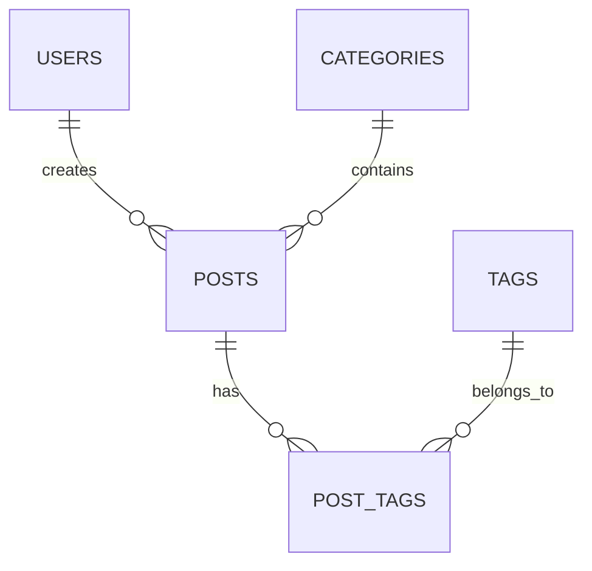

# 个人内容管理与展示平台 PRD

> 文档版本：v1.0  
> 项目周期：6～8 周，约 95～120 小时  
> 项目定位：个人全栈学习项目 / 求职作品集  
> 优先原则：可维护性 > 功能炫技  
> 目标用户：C 端访客、B 端作者（单一管理员）

---

## 1. 项目概述

### 1.1 一句话描述

一个面向个人技术内容创作与求职展示的全栈内容平台，让访客能够高效发现和阅读文章，让作者能够独立完成内容编辑、分类、发布和维护。

### 1.2 核心价值

对 C 端访客：

- 获得快速、清晰、适合移动端阅读的内容体验。
- 可以通过分类、标签和搜索快速找到感兴趣的文章。
- 可以从搜索引擎或社交分享链接直接进入文章详情页。

对 B 端作者：

- 通过简单的管理后台维护文章，不需要直接修改代码或数据库。
- 支持草稿、预览、发布、下线等基本内容工作流。
- 将个人内容、前端能力、后端能力和工程化实践集中展示在一个可访问项目中。

对求职目标：

- 展示从需求分析、数据库建模、API 设计到部署上线的完整全栈能力。
- 展示 SEO、性能优化、安全性和可维护性等非页面层面的工程意识。
- 形成一个可持续更新的作品，而不是一次性 Demo。

### 1.3 项目目标

- 在 1～2 个月业余时间内完成可上线版本。
- 实现完整的文章发布与展示闭环。
- 所有 P0 功能具备明确的验收标准。
- 移动端和桌面端均可正常使用。
- 项目代码结构清晰，可作为 TypeScript 全栈学习案例。
- 提供 README、数据库说明、API 文档和部署说明。

### 1.4 非目标

本期明确不做：

- 评论系统。
- 多管理员和复杂角色权限。
- 审核流、多人协作和内容审批。
- 会员、付费内容和电商功能。
- 原生 App。
- 自研富文本编辑器。
- Elasticsearch 等重型搜索基础设施。
- AI 自动写作、智能推荐等非核心功能。

### 1.5 成功标准

项目完成时应满足：

- 作者可以完成“登录 → 新建草稿 → 预览 → 发布 → C 端查看”的完整流程。
- 访客可以浏览、搜索并按分类或标签筛选已发布文章。
- 草稿、下线文章不会被未登录访客访问。
- 每篇文章具有独立 URL、SEO 标题、描述和 Open Graph 信息。
- 所有 P0 接口具备输入校验、错误处理和基本测试。
- 生产环境可访问，并具有数据库备份方案。
- README 能让其他开发者理解架构并在本地启动项目。

---

## 2. 用户角色与使用场景

### 2.1 用户角色

| 用户角色 | 核心目标 | 权限范围 | 主要入口 |
|---|---|---|---|
| C 端访客 | 阅读、搜索和发现内容 | 只能访问已发布内容 | 首页、文章详情、分类页、标签页、搜索页 |
| B 端作者 | 创作、发布和维护内容 | 登录后管理全部内容 | `/admin` 管理后台 |

### 2.2 C 端访客使用场景

#### 场景 C1：从搜索引擎进入文章

1. 访客搜索某个技术问题。
2. 通过搜索结果进入文章详情页。
3. 阅读文章正文、代码示例和关联标签。
4. 继续查看同分类或相关标签下的文章。

关键要求：

- 首屏加载速度快。
- 页面标题和描述与文章内容匹配。
- URL 稳定且具有可读性。
- 移动端具有良好的阅读体验。

#### 场景 C2：按主题发现内容

1. 访客进入首页。
2. 浏览最新文章或分类入口。
3. 进入分类或标签页面。
4. 分页浏览相关文章。

#### 场景 C3：主动搜索内容

1. 访客输入关键词。
2. 系统搜索文章标题、摘要。
3. 返回匹配结果。
4. 访客进入文章详情页。

MVP 阶段使用 PostgreSQL 模糊查询即可，不引入独立搜索服务。

### 2.3 B 端作者使用场景

#### 场景 B1：发布新文章

1. 作者登录管理后台。
2. 新建文章并填写标题、摘要、正文。
3. 选择分类和标签。
4. 设置文章 slug 和 SEO 信息。
5. 保存草稿并预览。
6. 确认后发布文章。

#### 场景 B2：修改已发布文章

1. 作者从文章列表找到目标文章。
2. 编辑正文或元数据。
3. 保存修改。
4. 系统刷新文章缓存。
5. C 端展示最新内容。

#### 场景 B3：下线文章

1. 作者将文章状态改为“已归档”。
2. 文章不再出现在列表和搜索结果中。
3. 原 URL 返回 404，或在 P1 阶段配置重定向。

#### 场景 B4：维护分类和标签

1. 作者创建、编辑或删除分类、标签。
2. 删除有关联文章的分类时，系统提示影响范围。
3. 删除标签时，仅删除文章与标签之间的关联关系。

---

## 3. 功能模块清单

优先级定义：

- **P0 必做**：构成完整内容发布闭环，缺失则项目不可上线。
- **P1 可做**：明显提升体验，但不影响 MVP 完整性。
- **P2 未来扩展**：用于长期迭代，不纳入当前工期承诺。

### 3.1 C 端功能

| 编号 | 功能 | 优先级 | 功能说明 |
|---|---|---:|---|
| C-01 | 首页 | P0 | 展示站点介绍、最新文章、主要分类 |
| C-02 | 文章列表 | P0 | 按发布时间倒序展示已发布文章 |
| C-03 | 文章详情 | P0 | 展示标题、摘要、发布时间、正文、分类和标签 |
| C-04 | 分页 | P0 | 文章列表和筛选结果支持分页 |
| C-05 | 分类浏览 | P0 | 查看某个分类下的全部已发布文章 |
| C-06 | 标签浏览 | P0 | 查看某个标签下的全部已发布文章 |
| C-07 | 基础搜索 | P0 | 按标题、摘要进行关键词模糊查询 |
| C-08 | 响应式布局 | P0 | 适配手机、平板和桌面端 |
| C-09 | Markdown 渲染 | P0 | 支持标题、列表、引用、链接、图片和代码块 |
| C-10 | 代码高亮 | P0 | 技术文章中的代码块支持语法高亮 |
| C-11 | 空状态与错误页 | P0 | 提供无结果、404 和系统错误页面 |
| C-12 | SEO 元数据 | P0 | 每个页面设置 title、description、canonical |
| C-13 | Sitemap 和 Robots | P0 | 自动生成 `sitemap.xml` 和 `robots.txt` |
| C-14 | Open Graph | P0 | 支持社交平台分享卡片 |
| C-15 | 文章目录 | P1 | 根据正文标题自动生成锚点目录 |
| C-16 | 相关文章 | P1 | 根据分类和标签推荐相关文章 |
| C-17 | RSS | P1 | 提供 `rss.xml` 订阅源 |
| C-18 | 深色模式 | P1 | 支持系统主题和手动切换 |
| C-19 | 阅读进度 | P2 | 展示页面阅读进度 |
| C-20 | 多语言 | P2 | 提供中文、英文内容版本 |
| C-21 | PWA | P2 | 支持安装和部分离线访问 |
| C-22 | 高级全文搜索 | P2 | 支持权重、相关度和搜索建议 |

### 3.2 B 端功能

| 编号 | 功能 | 优先级 | 功能说明 |
|---|---|---:|---|
| B-01 | 管理员登录 | P0 | 邮箱和密码登录，仅允许单一管理员 |
| B-02 | 退出登录 | P0 | 清除登录会话 |
| B-03 | 登录状态保护 | P0 | 未登录用户不能访问管理后台或管理接口 |
| B-04 | 文章列表 | P0 | 查看全部草稿、已发布和已归档文章 |
| B-05 | 新建文章 | P0 | 创建文章草稿 |
| B-06 | 编辑文章 | P0 | 修改标题、摘要、正文和 SEO 字段 |
| B-07 | 删除文章 | P0 | 删除前二次确认；建议仅允许删除草稿 |
| B-08 | 草稿保存 | P0 | 文章未完成时可以保存但不对外展示 |
| B-09 | 文章预览 | P0 | 发布前查看接近 C 端的渲染结果 |
| B-10 | 发布与下线 | P0 | 切换草稿、已发布、已归档状态 |
| B-11 | 分类管理 | P0 | 分类的新增、编辑、排序和删除 |
| B-12 | 标签管理 | P0 | 标签的新增、编辑和删除 |
| B-13 | Slug 管理 | P0 | 自动生成并允许发布前修改，保证唯一 |
| B-14 | SEO 字段管理 | P0 | 设置 SEO 标题、描述和分享图片 |
| B-15 | Markdown 编辑器 | P0 | 使用文本编辑与预览模式，不自研富文本能力 |
| B-16 | 自动保存 | P1 | 编辑过程中定时保存草稿 |
| B-17 | 图片上传 | P1 | 上传图片到对象存储并返回 URL |
| B-18 | 媒体库 | P1 | 查看和复用已经上传的图片 |
| B-19 | 定时发布 | P1 | 设置未来发布时间，由系统自动发布 |
| B-20 | 批量操作 | P1 | 批量归档或删除草稿 |
| B-21 | 简单数据看板 | P1 | 展示文章数、分类数和最近更新 |
| B-22 | 文章版本历史 | P2 | 查看和恢复历史内容 |
| B-23 | 导入导出 | P2 | Markdown 文件批量导入、导出 |
| B-24 | 多管理员权限 | P2 | 增加角色和权限模型 |
| B-25 | AI 内容辅助 | P2 | 摘要、标签和 SEO 描述建议 |

---

## 4. 技术选型建议

### 4.1 学习目标假设

本方案默认学习目标是：

- 掌握 TypeScript 全栈开发。
- 理解前端、API、数据库和部署之间的完整关系。
- 学习可维护的模块划分，而不是只实现页面效果。
- 最终形成适合求职展示的完整项目。

如果目标是 Java 后端岗位，可以将后端替换为 Spring Boot，其余数据库和 API 设计基本不变。但在 1～2 个月限制下，默认不建议同时学习两套语言和构建系统。

### 4.2 推荐技术栈

| 层级 | 推荐方案 | 选择原因 |
|---|---|---|
| 开发语言 | TypeScript | 前后端共享类型，减少上下文切换，适合全栈学习 |
| 前端框架 | Next.js App Router + React | 支持服务端渲染、静态生成、SEO 和后端接口 |
| UI 样式 | Tailwind CSS | 开发效率高，便于构建一致的响应式界面 |
| UI 组件 | shadcn/ui，按需使用 | 组件代码可读、可修改，适合作为学习案例 |
| 后端 | Next.js Route Handlers | 在一个项目中实现 REST API，避免额外服务复杂度 |
| 参数校验 | Zod | 运行时校验与 TypeScript 类型结合紧密 |
| 数据库 | PostgreSQL | 关系模型成熟，适合文章、分类、标签等数据 |
| ORM | Prisma ORM | Schema 清晰、类型安全，迁移记录适合学习数据库演进 |
| 身份认证 | Auth.js + Credentials | 使用成熟认证方案，避免自研会话系统 |
| 密码存储 | Argon2id | 使用现代密码哈希算法，不存储明文密码 |
| 内容格式 | Markdown | 可迁移、可版本管理，比自研富文本编辑器更可控 |
| 单元测试 | Vitest | 与 TypeScript 和现代前端工具链集成良好 |
| 组件测试 | Testing Library | 从用户行为角度测试页面和组件 |
| E2E 测试 | Playwright | 验证登录、发布、阅读等关键链路 |
| 本地环境 | Docker Compose | 一键启动 PostgreSQL，减少环境差异 |
| 前端及 API 部署 | Vercel | 对 Next.js 支持完整，配置和维护成本较低 |
| 生产数据库 | Neon 或 Supabase PostgreSQL | 提供托管 PostgreSQL、备份和连接管理 |
| 图片存储 | Cloudflare R2、S3 或 Vercel Blob | 避免将上传文件存入应用实例磁盘 |
| 监控 | Vercel Analytics + Sentry，可选 | 分别覆盖性能数据和异常追踪 |

### 4.3 推荐部署形态

博客和管理后台使用同一个项目：

```text
https://example.com/              # C 端博客
https://example.com/posts/xxx     # 文章详情
https://example.com/admin         # B 端管理后台
https://example.com/api/v1/...    # REST API
```

推荐“物理上放在一起，逻辑上严格分开”：

- 同一个 Git 仓库。
- 同一个 Next.js 应用。
- 同一次 Vercel 部署。
- 共用一个 PostgreSQL 数据库。
- C 端和 B 端使用不同页面目录、布局和组件。
- 共用文章、分类、标签等业务 Service。
- `/admin` 页面和 `/api/v1/admin/*` 接口必须进行登录校验。
- C 端查询必须在服务端强制添加 `status = PUBLISHED`。

### 4.4 技术控制原则

- 不在页面组件中直接调用 Prisma。
- 不用 Server Actions 替代全部 REST API。
- 不提前拆分微服务。
- 不创建没有实际需求的通用框架。
- 不自研认证、富文本编辑器和对象存储。
- 不在 MVP 阶段引入 Redis、消息队列和搜索集群。
- 依赖使用稳定版本并提交 lockfile，不盲目追逐最新版本。

---

## 5. 数据库设计草案

### 5.1 实体关系



### 5.2 `users` 用户表

| 字段 | 类型 | 约束 | 说明 |
|---|---|---|---|
| `id` | UUID | PK | 用户 ID |
| `email` | VARCHAR(255) | UNIQUE, NOT NULL | 登录邮箱 |
| `password_hash` | VARCHAR(255) | NOT NULL | Argon2id 密码哈希 |
| `display_name` | VARCHAR(50) | NOT NULL | 展示名称 |
| `avatar_url` | TEXT | NULL | 头像地址 |
| `bio` | VARCHAR(300) | NULL | 作者简介 |
| `is_active` | BOOLEAN | DEFAULT TRUE | 是否允许登录 |
| `session_version` | INTEGER | DEFAULT 1 | 用于使旧会话失效 |
| `last_login_at` | TIMESTAMPTZ | NULL | 最近登录时间 |
| `created_at` | TIMESTAMPTZ | NOT NULL | 创建时间 |
| `updated_at` | TIMESTAMPTZ | NOT NULL | 更新时间 |

P0 阶段不需要 `role` 字段：系统中所有有效用户均视为管理员。

### 5.3 `posts` 文章表

| 字段 | 类型 | 约束 | 说明 |
|---|---|---|---|
| `id` | UUID | PK | 文章 ID |
| `author_id` | UUID | FK, NOT NULL | 关联作者 |
| `category_id` | UUID | FK, NULL | 关联分类 |
| `title` | VARCHAR(120) | NOT NULL | 文章标题 |
| `slug` | VARCHAR(160) | UNIQUE, NOT NULL | URL 唯一标识 |
| `excerpt` | VARCHAR(300) | NOT NULL | 文章摘要 |
| `content_md` | TEXT | NOT NULL | Markdown 正文 |
| `cover_image_url` | TEXT | NULL | 封面图片 |
| `status` | ENUM | NOT NULL | `DRAFT`、`PUBLISHED`、`ARCHIVED` |
| `seo_title` | VARCHAR(60) | NULL | SEO 标题 |
| `seo_description` | VARCHAR(160) | NULL | SEO 描述 |
| `published_at` | TIMESTAMPTZ | NULL | 发布时间 |
| `created_at` | TIMESTAMPTZ | NOT NULL | 创建时间 |
| `updated_at` | TIMESTAMPTZ | NOT NULL | 更新时间 |

业务约束：

- `PUBLISHED` 状态必须存在 `published_at`。
- `slug` 只能包含小写字母、数字和连字符。
- `slug` 发布后原则上不可修改。
- C 端只能查询 `PUBLISHED` 状态文章。
- P0 阶段使用 `ARCHIVED` 代替复杂的软删除机制。
- 不在文章表保存浏览量，访问统计交给分析工具处理。

### 5.4 `categories` 分类表

| 字段 | 类型 | 约束 | 说明 |
|---|---|---|---|
| `id` | UUID | PK | 分类 ID |
| `name` | VARCHAR(40) | UNIQUE, NOT NULL | 分类名称 |
| `slug` | VARCHAR(60) | UNIQUE, NOT NULL | 分类 URL 标识 |
| `description` | VARCHAR(200) | NULL | 分类说明 |
| `sort_order` | INTEGER | DEFAULT 0 | 展示顺序 |
| `created_at` | TIMESTAMPTZ | NOT NULL | 创建时间 |
| `updated_at` | TIMESTAMPTZ | NOT NULL | 更新时间 |

删除分类时，相关文章的 `category_id` 设置为 `NULL`，但管理后台必须先提示影响范围。

### 5.5 `tags` 标签表

| 字段 | 类型 | 约束 | 说明 |
|---|---|---|---|
| `id` | UUID | PK | 标签 ID |
| `name` | VARCHAR(30) | UNIQUE, NOT NULL | 标签名称 |
| `slug` | VARCHAR(50) | UNIQUE, NOT NULL | 标签 URL 标识 |
| `created_at` | TIMESTAMPTZ | NOT NULL | 创建时间 |
| `updated_at` | TIMESTAMPTZ | NOT NULL | 更新时间 |

### 5.6 `post_tags` 文章标签关联表

| 字段 | 类型 | 约束 | 说明 |
|---|---|---|---|
| `post_id` | UUID | PK, FK | 文章 ID |
| `tag_id` | UUID | PK, FK | 标签 ID |
| `created_at` | TIMESTAMPTZ | NOT NULL | 关联创建时间 |

使用 `(post_id, tag_id)` 作为联合主键，避免重复关联。

### 5.7 `media_assets` 媒体资源表（P1）

| 字段 | 类型 | 约束 | 说明 |
|---|---|---|---|
| `id` | UUID | PK | 资源 ID |
| `owner_id` | UUID | FK, NOT NULL | 上传者 |
| `file_name` | VARCHAR(255) | NOT NULL | 原始文件名 |
| `storage_key` | VARCHAR(500) | UNIQUE, NOT NULL | 对象存储 Key |
| `url` | TEXT | NOT NULL | 访问地址 |
| `mime_type` | VARCHAR(100) | NOT NULL | 文件类型 |
| `size_bytes` | INTEGER | NOT NULL | 文件大小 |
| `created_at` | TIMESTAMPTZ | NOT NULL | 上传时间 |

### 5.8 索引建议

```sql
CREATE UNIQUE INDEX users_email_uq
ON users (LOWER(email));

CREATE UNIQUE INDEX posts_slug_uq
ON posts (slug);

CREATE INDEX posts_status_published_at_idx
ON posts (status, published_at DESC);

CREATE INDEX posts_category_status_idx
ON posts (category_id, status);

CREATE INDEX post_tags_tag_post_idx
ON post_tags (tag_id, post_id);
```

搜索优化建议：

- P0：使用 `ILIKE` 查询标题和摘要。
- P1：数据量增加后启用 PostgreSQL `pg_trgm` 和 GIN 索引。
- 不建议当前阶段引入 Elasticsearch 或 Meilisearch。

---

## 6. API 接口清单

统一前缀：

```text
/api/v1
```

### 6.1 公共接口

| 方法 | URL | 权限 | 用途 |
|---|---|---|---|
| GET | `/api/v1/posts` | 公开 | 获取已发布文章列表 |
| GET | `/api/v1/posts/{slug}` | 公开 | 获取文章详情 |
| GET | `/api/v1/search?q={keyword}` | 公开 | 搜索已发布文章 |
| GET | `/api/v1/categories` | 公开 | 获取分类列表 |
| GET | `/api/v1/categories/{slug}/posts` | 公开 | 获取分类下的文章 |
| GET | `/api/v1/tags` | 公开 | 获取标签列表 |
| GET | `/api/v1/tags/{slug}/posts` | 公开 | 获取标签下的文章 |

### 6.2 认证接口

| 方法 | URL | 权限 | 用途 |
|---|---|---|---|
| POST | `/api/v1/auth/login` | 公开 | 管理员登录 |
| POST | `/api/v1/auth/logout` | 已登录 | 退出登录 |
| GET | `/api/v1/auth/me` | 已登录 | 获取当前登录用户 |

### 6.3 管理端文章接口

| 方法 | URL | 用途 |
|---|---|---|
| GET | `/api/v1/admin/posts` | 获取全部状态的文章 |
| POST | `/api/v1/admin/posts` | 创建文章草稿 |
| GET | `/api/v1/admin/posts/{id}` | 获取文章编辑数据 |
| PATCH | `/api/v1/admin/posts/{id}` | 更新文章内容或状态 |
| DELETE | `/api/v1/admin/posts/{id}` | 删除文章草稿 |

### 6.4 管理端分类接口

| 方法 | URL | 用途 |
|---|---|---|
| GET | `/api/v1/admin/categories` | 获取分类列表 |
| POST | `/api/v1/admin/categories` | 创建分类 |
| PATCH | `/api/v1/admin/categories/{id}` | 更新分类 |
| DELETE | `/api/v1/admin/categories/{id}` | 删除分类 |

### 6.5 管理端标签接口

| 方法 | URL | 用途 |
|---|---|---|
| GET | `/api/v1/admin/tags` | 获取标签列表 |
| POST | `/api/v1/admin/tags` | 创建标签 |
| PATCH | `/api/v1/admin/tags/{id}` | 更新标签 |
| DELETE | `/api/v1/admin/tags/{id}` | 删除标签 |

### 6.6 P1 接口

| 方法 | URL | 用途 |
|---|---|---|
| POST | `/api/v1/admin/media/presign` | 申请图片直传地址 |
| POST | `/api/v1/admin/media/complete` | 确认上传并保存资源 |
| GET | `/api/v1/admin/media` | 获取媒体库 |
| DELETE | `/api/v1/admin/media/{id}` | 删除未使用资源 |
| GET | `/api/v1/admin/dashboard` | 获取后台统计数据 |
| POST | `/api/v1/admin/posts/batch` | 批量操作文章 |

### 6.7 响应格式

成功响应：

```json
{
  "data": {
    "id": "4a4f...",
    "title": "文章标题"
  }
}
```

分页响应：

```json
{
  "data": [],
  "pagination": {
    "page": 1,
    "pageSize": 10,
    "total": 35,
    "totalPages": 4
  }
}
```

错误响应：

```json
{
  "error": {
    "code": "POST_SLUG_EXISTS",
    "message": "文章 slug 已存在",
    "requestId": "req_123"
  }
}
```

### 6.8 HTTP 状态码约定

| 状态码 | 使用场景 |
|---:|---|
| 200 | 查询或更新成功 |
| 201 | 创建成功 |
| 204 | 删除成功且无响应正文 |
| 400 | 请求格式错误 |
| 401 | 未登录或会话失效 |
| 403 | 已登录但无权访问 |
| 404 | 资源不存在 |
| 409 | slug、邮箱等唯一字段冲突 |
| 422 | 参数格式正确但业务校验失败 |
| 429 | 请求过于频繁 |
| 500 | 未处理的服务端错误 |

---

## 7. 非功能性需求

### 7.1 性能目标

以真实移动端数据的第 75 百分位为目标：

| 指标 | 目标 |
|---|---:|
| LCP | ≤ 2.5 秒 |
| INP | ≤ 200 毫秒 |
| CLS | ≤ 0.1 |
| Lighthouse Performance | ≥ 90 |
| 公共查询接口 P95 | ≤ 400 毫秒，不含冷启动 |
| 管理写接口 P95 | ≤ 800 毫秒，不含图片上传 |

实现策略：

- 首页、文章详情优先使用静态生成或 ISR。
- 文章发布后按路径主动刷新缓存。
- 减少不必要的客户端 JavaScript。
- 使用 Next.js Image 或等价方案优化图片。
- 图片使用 WebP 或 AVIF，并明确设置尺寸。
- 代码高亮尽量在服务端完成。
- 公共列表接口设置合理缓存。
- 分页大小默认 10，最大不超过 50。
- 避免文章列表中的 N+1 查询。

### 7.2 SEO 要求

- 每个页面具有唯一的 `title` 和 `description`。
- 每篇文章具有稳定、可读的 slug。
- 输出 canonical URL。
- 自动生成 `sitemap.xml`。
- 提供正确的 `robots.txt`。
- 草稿、后台页面设置 `noindex`。
- 文章页面包含 Open Graph 和 Twitter Card 信息。
- 使用语义化 HTML 和正确标题层级。
- 输出 `Article`、`Person` 和 `BreadcrumbList` JSON-LD。
- 图片包含有意义的 `alt`。
- 文章发布日期和更新时间可被搜索引擎读取。
- slug 发布后禁止随意修改。

### 7.3 安全性要求

- 密码使用 Argon2id 哈希，不保存明文。
- 登录会话使用 `HttpOnly`、`Secure`、`SameSite` Cookie。
- 登录失败不能暴露邮箱是否存在。
- 登录接口增加 IP 和账号频率限制。
- 管理后台页面和 API 均进行服务端鉴权。
- 所有 API 输入通过 Zod 校验。
- Markdown 默认不允许执行原始 HTML。
- 禁止 `javascript:` 等危险链接协议。
- 不直接拼接 SQL。
- 上传文件校验 MIME、扩展名和大小。
- 错误响应不返回堆栈、连接信息和内部路径。
- 环境变量不提交到 Git。
- 生产数据库启用自动备份。

### 7.4 可维护性要求

- TypeScript 开启严格模式。
- ESLint 和格式化检查必须通过。
- 数据库变更必须通过 migration 提交。
- Route Handler 只负责协议转换，不堆积业务逻辑。
- 业务错误使用统一错误类型。
- API 返回统一响应格式。
- 关键函数和业务规则必须有单元测试。
- README 包含启动、测试、迁移和部署命令。

### 7.5 测试要求

P0 测试范围：

- Slug 生成和唯一性校验。
- 文章状态转换。
- 草稿不能通过公共接口获取。
- 登录成功、失败和退出。
- 未登录用户不能访问管理接口。
- 文章创建、编辑和发布 API。
- 分类、标签关联。
- Markdown 安全渲染。
- “登录 → 发布 → C 端查看”E2E 流程。

---

## 8. 开发里程碑建议

### 8.1 阶段一：MVP

周期：第 1～4 周  
预计投入：50～65 小时

#### 第 1 周：项目基础

- 初始化 Next.js、TypeScript、Tailwind。
- 配置 ESLint、格式化和环境变量。
- 使用 Docker Compose 启动 PostgreSQL。
- 完成 Prisma Schema 和首次迁移。
- 编写 Seed，创建管理员和示例内容。
- 建立 Service、Repository 和错误处理结构。

#### 第 2 周：认证与基础后台

- 实现管理员登录、退出。
- 保护 `/admin` 页面和管理 API。
- 实现分类、标签 CRUD。
- 实现管理后台基础布局。
- 增加登录限流和统一错误返回。

#### 第 3 周：文章管理

- 实现文章列表、新建、编辑和删除草稿。
- 实现 Markdown 编辑与预览。
- 实现 slug 生成和唯一性校验。
- 实现草稿、发布、归档状态。
- 实现 SEO 字段编辑。

#### 第 4 周：C 端与首次上线

- 实现首页、文章列表和文章详情。
- 实现分类页、标签页。
- 实现基础搜索和分页。
- 完成响应式适配。
- 部署 Vercel 和生产 PostgreSQL。

MVP 完成标准：

- C/B 两端形成完整闭环。
- 所有 P0 核心功能可以在生产环境演示。
- 不存在阻断使用的严重错误。

### 8.2 阶段二：完善版

周期：第 5～6 周  
预计投入：25～30 小时

- 完成 Metadata、canonical 和 Open Graph。
- 生成 Sitemap 和 Robots。
- 增加 JSON-LD、文章目录、相关文章和 RSS。
- 补充核心 Service 单元测试。
- 补充 API 集成测试。
- 使用 Playwright 覆盖关键链路。
- 根据时间实现自动保存或图片上传。

### 8.3 阶段三：优化版

周期：第 7～8 周  
预计投入：20～25 小时

- 分析客户端 Bundle。
- 优化图片、字体和代码高亮。
- 检查慢查询和 N+1 查询。
- 配置安全响应头。
- 完成依赖漏洞检查。
- 接入错误监控。
- 验证备份和恢复流程。
- 补充架构图、ER 图和 API 文档。
- 录制项目演示视频并整理简历描述。

### 8.4 总工期

| 阶段 | 时间 | 预计工时 |
|---|---:|---:|
| MVP | 4 周 | 50～65 小时 |
| 完善版 | 2 周 | 25～30 小时 |
| 优化版 | 2 周 | 20～25 小时 |
| 合计 | 6～8 周 | 95～120 小时 |

### 8.5 延期时的裁剪顺序

1. 暂缓 P2 全部功能。
2. 暂缓媒体库、定时发布和批量操作。
3. 暂缓深色模式、相关文章和 RSS。
4. 图片暂时只支持填写 URL。
5. 保留测试、SEO、安全和错误处理，不用降低代码质量换取装饰功能。
6. 不在中途改为前后端分离或引入新框架。

---

## 9. 求职亮点提炼

### 9.1 简历描述示例

> 独立设计并开发基于 Next.js、TypeScript、PostgreSQL 和 Prisma 的个人内容管理平台，实现文章草稿、预览、发布、分类标签、搜索及单管理员后台，并完成 SEO、响应式设计、数据库迁移、自动化测试和生产部署。

> 使用 Next.js App Router 构建面向访客的服务端渲染页面及 RESTful API，通过 Service/Repository 分层隔离业务逻辑与 Prisma 数据访问；设计文章、分类、标签多对多关系及状态流转模型，实现基于 Cookie 的管理员认证、Zod 参数校验和统一错误处理。

> 通过静态生成/ISR、按路径缓存刷新、图片优化和服务端代码高亮降低客户端负载；使用 Vitest、Testing Library 和 Playwright 覆盖文章发布主链路，并配置数据库迁移、Docker 本地环境、生产部署和错误监控。

### 9.2 可量化描述模板

项目上线并完成实际测试后，再填写真实数据：

- Lighthouse Performance 从 `[优化前分数]` 提升到 `[优化后分数]`。
- 移动端 LCP 优化至 `[实际结果]` 秒。
- 核心业务单元测试覆盖率达到 `[实际结果]%`。
- 使用 Playwright 覆盖 `[实际数量]` 条关键用户链路。
- API P95 响应时间控制在 `[实际结果]` 毫秒以内。
- 累计发布 `[实际数量]` 篇技术文章。

不要在简历中填写未经实际测量的性能或流量数据。

### 9.3 能体现的技术能力

| 能力方向 | 项目体现 |
|---|---|
| 产品意识 | 根据时间和用户价值划分 P0、P1、P2 |
| 前端开发 | React、Next.js、响应式布局、表单和 Markdown 渲染 |
| 服务端开发 | REST API、认证、参数校验、错误处理 |
| 数据库设计 | 一对多、多对多、索引、约束、迁移 |
| TypeScript | 前后端统一类型、严格模式、Schema 推导 |
| 架构能力 | Service/Repository 分层、模块边界 |
| SEO | SSR/静态生成、Metadata、Sitemap、JSON-LD |
| 性能优化 | Core Web Vitals、缓存、图片和 Bundle 优化 |
| 安全意识 | 密码哈希、Cookie、安全响应头、限流、XSS 防护 |
| 测试能力 | 单元测试、集成测试、E2E 测试 |
| 工程化 | Docker、CI、环境配置、部署和监控 |
| 文档能力 | PRD、ER 图、API 文档、README 和技术复盘 |

### 9.4 最终作品集应包含

- 可访问的线上地址。
- GitHub 仓库。
- 完整 README。
- 架构图和 ER 图。
- API 接口说明。
- 本地开发和部署步骤。
- 自动化测试说明。
- 性能测试截图。
- 2～3 分钟项目演示视频。
- 一篇项目复盘文章，包括取舍、问题和优化过程。

---

## 10. 最终范围确认

P0 交付范围：

- C 端首页、列表、详情、分类、标签、搜索和响应式页面。
- B 端登录、文章 CRUD、草稿、预览、发布、归档。
- 分类和标签管理。
- PostgreSQL 数据库及 Prisma 迁移。
- RESTful API。
- 基础 SEO、Sitemap、Robots 和 Open Graph。
- 基本安全防护、自动化测试及生产部署。

明确排除：

- 评论系统。
- 多角色权限。
- 复杂工作流。
- 自研富文本编辑器。
- 微服务和独立搜索集群。
- 仅用于展示但显著增加维护成本的炫技功能。

核心实施原则：

> 先完成稳定、可测试、可部署的内容闭环，再增加体验型功能。每引入一个新技术，都必须能够回答“它解决了什么真实问题”。

---

## 11. 参考资料

- [Next.js Route Handlers](https://nextjs.org/docs/app/getting-started/route-handlers)
- [Next.js Metadata and OG Images](https://nextjs.org/docs/app/getting-started/metadata-and-og-images)
- [Next.js Backend for Frontend](https://nextjs.org/docs/app/guides/backend-for-frontend)
- [Prisma ORM](https://www.prisma.io/docs/orm)
- [Prisma Migrate](https://www.prisma.io/docs/orm/prisma-migrate)
- [Core Web Vitals](https://web.dev/articles/defining-core-web-vitals-thresholds)
- [OWASP Password Storage Cheat Sheet](https://cheatsheetseries.owasp.org/cheatsheets/Password_Storage_Cheat_Sheet.html)
