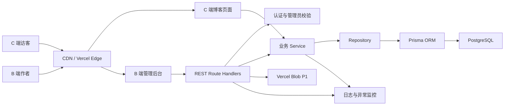
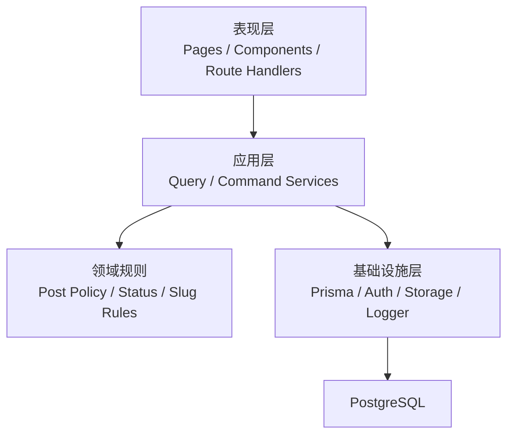
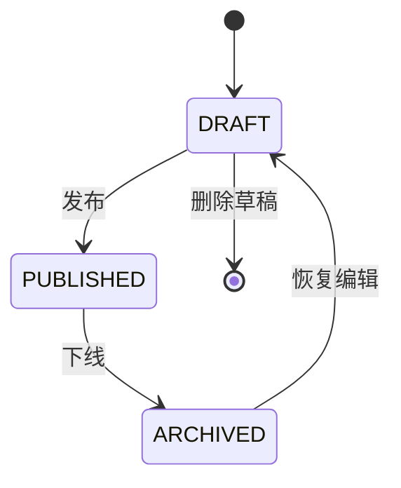
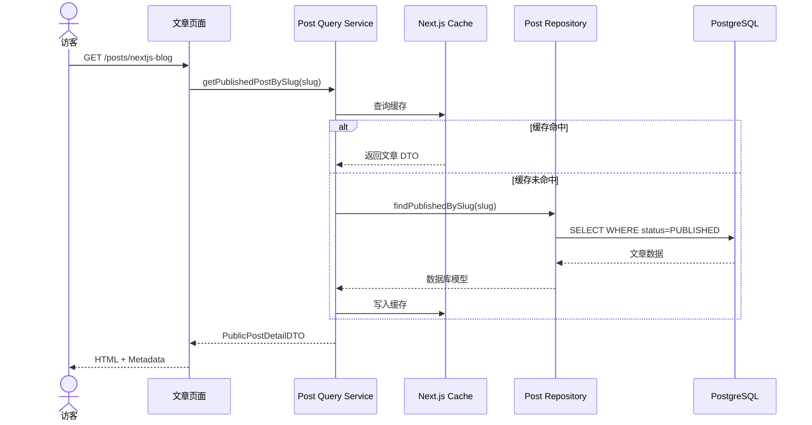
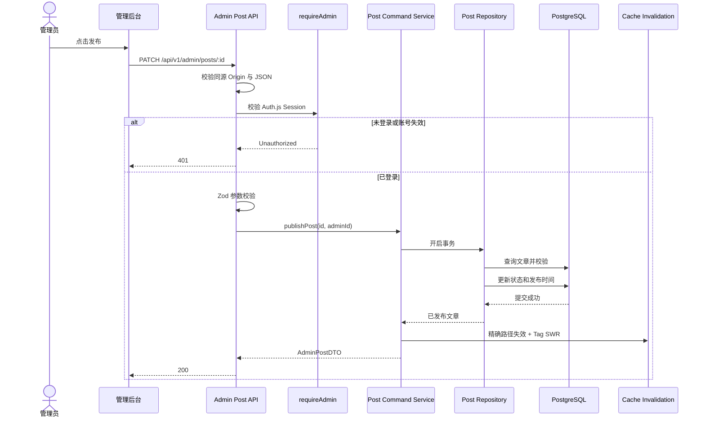
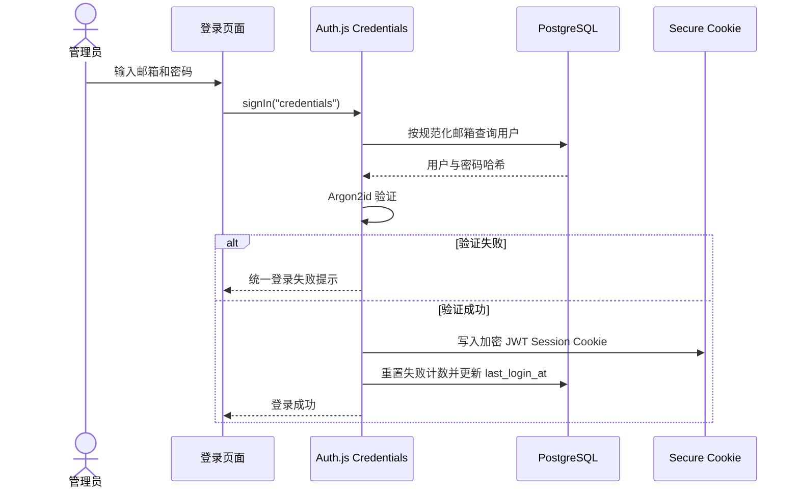
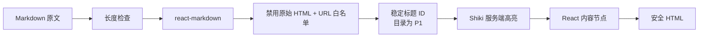
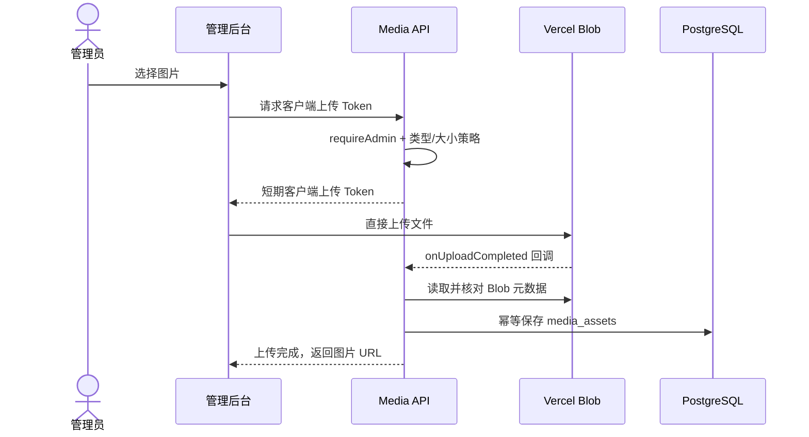
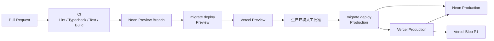

# 个人博客与内容管理平台：详细技术架构设计

> 架构版本：v1.2（2026-07-29 UI 实施基线同步版）  
> 对应 PRD：个人内容管理与展示平台 PRD v1.0  
> 对应 UI：`design/Leon-Blog-UI设计规范.md` v0.2  
> 架构类型：模块化单体应用  
> 部署模式：单仓库、单应用、单数据库  
> 核心原则：物理部署在一起，业务逻辑清晰分离

---

## 0. 最终架构决策摘要

本节是全文唯一的架构基线；后续章节只能展开这些决策，不能给出另一套可选方案。

| 决策项 | 唯一结论 | 阶段 |
|---|---|---:|
| 应用形态 | 单仓库、单个 Next.js 16 App Router 应用、单个 PostgreSQL 数据库；不使用 NestJS，不建立多应用 workspace | P0 |
| 项目结构 | 根目录就是应用根；使用单项目 pnpm、`src/app`、`src/modules`、`prisma`，不创建 pnpm workspace，不出现 `apps/web` 或 `apps/api` | P0 |
| 公共读取 | 公共页面的 Server Components 直接调用只返回 `PUBLISHED` 的 Query Service；不通过本应用 Route Handler 发内部 HTTP 请求 | P0 |
| 浏览器写入 | 管理端交互使用 Client Component，通过同源 `/api/v1/admin/*` Route Handlers 写入；内容业务不使用 Server Actions | P0 |
| 公共 API | 保留 PRD 要求的 `/api/v1/*` REST Route Handlers，供测试和可能的外部读取；页面与 API 共用 Service | P0 |
| Server/Client 边界 | 页面、布局、数据读取和 Markdown 主体默认 Server Component；只有表单交互、搜索输入和主题切换等最小交互岛使用 Client Component | P0/P1 |
| 认证 | Auth.js Credentials；无注册；Argon2id；使用 Auth.js 的加密 JWT Session Cookie，不建 `sessions` 表，不使用可供第三方 API 调用的 Bearer JWT | P0 |
| 认证入口 | `/admin/login` 是自定义登录页；登录/退出只调用 Auth.js `signIn`/`signOut`；`/api/auth/[...nextauth]` 由 Auth.js 独占，不再手写第二套登录/退出接口 | P0 |
| 权限校验 | `proxy.ts` 只做乐观跳转；管理页面的数据读取和每个管理 Route Handler 都在数据访问前调用 `requireAdmin()`，并查询用户的 `isActive` 与 `sessionVersion` | P0 |
| CSRF | Auth.js 认证入口使用其内置 CSRF；自建管理写接口统一校验同源 `Origin`、仅接受 JSON、Cookie 使用 `SameSite=Lax`，且不开 CORS | P0 |
| API 契约 | 使用 Zod Schema、DTO、Markdown 接口表和集成测试作为契约；单应用不引入 OpenAPI 与生成客户端 | P0 |
| 数据库 | PostgreSQL + Prisma ORM 7；`prisma.config.ts` 管理 CLI 连接，运行时使用 `@prisma/adapter-pg`；应用流量使用池化连接 | P0 |
| UI | 以 UI 规范 v0.2 为视觉事实来源；Tailwind CSS + 语义 CSS 变量；P0 使用中文系统字体栈和浅色主题，`md`/`lg` 移动优先断点；shadcn/ui 只按已出现的表单、弹窗等需求逐个引入 | P0 |
| 首页作品证据 | 只作为首页静态内容，从受类型约束的站点配置读取；不增加项目表、项目后台、项目 API 或 `/projects` 路由 | P0 |
| 主题 | P0 组件全部消费语义颜色变量但只提供浅色值；P1 使用同一变量增加浅色/深色/跟随系统和持久化选择，不改变组件 API | P0/P1 |
| 测试 | Vitest 覆盖纯规则和 Service，Testing Library 覆盖关键交互组件，Playwright 覆盖登录—发布—公开阅读主链路 | P0 |
| 缓存 | 启用 Next.js 16 Cache Components；公共 Query 函数显式使用 `'use cache'`、`cacheLife`、`cacheTag`；搜索和管理数据不缓存 | P0 |
| 发布刷新 | 数据库事务提交后，在同一个管理 Route Handler 中执行精确 `revalidatePath`，并用 `revalidateTag(tag, "max")` 标记共享数据为 SWR；不建设刷新 webhook | P0 |
| 图片 | P0 只录入经过 HTTPS 与域名白名单校验的 URL；P1 唯一选用 Vercel Blob 浏览器直传和轻量媒体列表 | P0/P1 |
| slug | P0 发布后锁定；归档后原地址返回 404；P1 才允许修改已发布 slug，并在同一事务记录旧值，旧地址用 308 永久跳转 | P0/P1 |
| 监控 | P0 使用结构化日志、requestId、Vercel Logs 与 Vercel Analytics；P1 固定接入 Sentry，不同时接入第二套异常平台 | P0/P1 |
| 部署 | Local：Docker PostgreSQL；Preview：Vercel Preview + Neon 预览分支；Production：Vercel + Neon PostgreSQL，生产迁移通过受控 CI 的 `prisma migrate deploy` 后再部署 | P0 |
| P1 体验 | 文章目录、相关文章、RSS、深浅主题、自动保存、图片上传/媒体列表、定时发布、批量操作和简单数据看板只在 P0 闭环完成后实施 | P1 |
| P1 定时发布 | 唯一使用 Vercel Cron 每 5 分钟调用受 `CRON_SECRET` 保护的 Route Handler；PostgreSQL 事务幂等领取到期草稿，提交后走同一发布缓存失效；不引入队列或 Redis。该频率要求 Vercel Pro | P1 |
| P2 | 版本历史、导入导出、多管理员、AI 内容辅助、多语言、PWA、高级搜索；不提前建表或抽象 | P2 |

明确排除：

- NestJS、微服务、`pnpm workspace` 多应用结构。
- RBAC、多套认证、数据库 Session 与 JWT Session 并存。
- Server Actions、Route Handlers、独立 API 三套内容写入入口。
- Redis、消息队列、Elasticsearch、GraphQL、API Gateway。
- P0 媒体中心、工作流、统计平台和 slug 重定向表。
- 为首页作品证据新增项目数据模型、CRUD 或独立作品产品线。

---

## 1. 架构目标

本架构需要同时满足以下目标：

- C 端博客与 B 端管理后台共用一个 Next.js 项目。
- C 端、B 端、API、业务逻辑和数据库访问具有明确边界。
- 适合一个人维护，不引入微服务等不必要复杂度。
- 支持文章草稿、预览、发布、归档的完整流程。
- 保证草稿和管理数据不会通过 C 端泄露。
- 支持 SEO、缓存、响应式页面和良好的访问性能。
- 方便编写单元测试、集成测试和 E2E 测试。
- 代码能够作为 TypeScript 全栈学习案例和求职作品。

---

## 2. 核心架构决策展开

| 决策项 | 选择 |
|---|---|
| 架构类型 | 模块化单体 |
| 代码仓库 | 单仓库 |
| Web 应用 | 单个 Next.js 应用 |
| C 端地址 | `/`、`/posts/*`、`/categories/*`、`/tags/*` |
| B 端地址 | `/admin/*` |
| API 地址 | `/api/v1/*` |
| 数据库 | 单个 PostgreSQL |
| ORM | Prisma |
| 认证 | Auth.js Credentials + 加密 JWT Session Cookie |
| 内容格式 | Markdown 原文入库 |
| 部署 | Vercel + Neon PostgreSQL |
| 图片 | P0 使用白名单 URL；P1 唯一接入 Vercel Blob |
| 搜索 | P0 PostgreSQL 标题/摘要模糊查询；相关度、权重和建议属于 P2，本期不建设 |
| 缓存 | Next.js 16 Cache Components + 精确路径失效 + Tag SWR |
| 权限 | 单管理员，不设计 RBAC |
| OpenAPI | 不引入；Zod、DTO、接口表与集成测试即契约 |
| 内容写入 | 同源管理 Route Handlers；不使用内容 Server Actions |

架构结论：

> 博客和管理后台部署在同一个应用中，但页面、组件、接口和业务模块分别组织。二者共享文章、分类、标签等业务层，不共享不必要的页面状态。

---

## 3. 系统上下文



### 3.1 C 端博客

负责：

- 首页。
- 首页静态作者定位与一条作品能力证据。
- 文章列表和详情。
- 分类、标签和搜索。
- SEO 元数据。
- Sitemap、Robots、Open Graph。
- Markdown 内容展示。

C 端页面主要使用 Server Components，服务端直接调用查询 Service。

### 3.2 B 端管理后台

负责：

- 管理员登录。
- 文章创建、编辑、预览和发布。
- 分类和标签管理。
- SEO 字段管理。
- 图片上传和轻量媒体列表，P1。

B 端允许使用 Client Components 处理复杂表单和交互，通过 REST API 提交数据。

### 3.3 REST API

负责：

- 解析 HTTP 请求。
- 验证登录状态。
- 使用 Zod 校验输入。
- 调用业务 Service。
- 将业务结果转换为 API DTO。
- 返回统一响应和错误格式。

### 3.4 业务 Service

负责：

- 文章发布规则。
- 草稿、发布、归档状态流转。
- slug 规则。
- 分类和标签关联。
- 事务边界。
- 缓存失效决策。

### 3.5 Repository

负责：

- 封装 Prisma 查询。
- 控制数据库字段选择。
- 避免 N+1 查询。
- 隔离具体数据库实现。

---

## 4. 分层架构



### 4.1 表现层

包含：

- C 端页面。
- B 端页面。
- React 组件。
- Route Handlers。
- 页面 Metadata。
- API DTO。

表现层不能直接调用 Prisma。

视觉与布局值不能散落为任意色值和尺寸；公共页面与管理端都消费 `globals.css` 中的语义变量，并服从 `design/Leon-Blog-UI设计规范.md` v0.2。

不推荐：

```ts
export default async function Page() {
  const posts = await prisma.post.findMany()
  return <PostList posts={posts} />
}
```

推荐：

```ts
export default async function Page() {
  const posts = await postQueryService.listPublishedPosts({
    page: 1,
    pageSize: 10,
  })

  return <PostList posts={posts.items} />
}
```

### 4.2 应用层

查询 Service 负责读取：

- `listPublishedPosts`
- `getPublishedPostBySlug`
- `searchPublishedPosts`
- `listPostsByCategory`
- `listPostsByTag`
- `listAdminPosts`

命令 Service 负责写入：

- `createDraft`
- `updatePost`
- `publishPost`
- `archivePost`
- `deleteDraft`
- `createCategory`
- `updateCategory`
- `deleteCategory`

读写分开只是为了把“公开读取约束”和“管理写入规则”隔离，不引入消息、事件总线或完整 CQRS。

### 4.3 领域规则

领域层包含纯业务规则：

- 哪些文章可以发布。
- 哪些文章可以删除。
- slug 是否合法。
- 状态是否允许转换。
- 发布时需要哪些字段。
- 标签数量是否超过限制。

领域规则尽量写成不依赖 Next.js 和 Prisma 的纯函数，便于测试。

### 4.4 基础设施层

包含：

- Prisma Client。
- Repository。
- Auth.js 配置。
- Auth.js JWT Session Cookie。
- Vercel Blob，P1。
- 日志。
- 错误监控。
- Vercel WAF IP 限流与用户表账号锁定字段。

---

## 5. 推荐项目目录

```text
src/
├── app/
│   ├── layout.tsx                    # 唯一根布局，包含 html/body
│   ├── globals.css                   # 语义 Token、基础样式、浅色主题
│   ├── (site)/
│   │   ├── layout.tsx
│   │   ├── page.tsx
│   │   ├── loading.tsx
│   │   ├── error.tsx
│   │   ├── posts/
│   │   │   ├── page.tsx
│   │   │   └── [slug]/
│   │   │       ├── page.tsx
│   │   │       ├── loading.tsx
│   │   │       └── not-found.tsx
│   │   ├── categories/
│   │   │   ├── page.tsx
│   │   │   └── [slug]/
│   │   │       └── page.tsx
│   │   ├── tags/
│   │   │   ├── page.tsx
│   │   │   └── [slug]/
│   │   │       └── page.tsx
│   │   └── search/
│   │       └── page.tsx
│   │
│   ├── (auth)/
│   │   └── admin/
│   │       └── login/
│   │           └── page.tsx
│   │
│   ├── (admin)/
│   │   └── admin/
│   │       ├── layout.tsx
│   │       ├── page.tsx
│   │       ├── posts/
│   │       │   ├── page.tsx
│   │       │   ├── new/
│   │       │   │   └── page.tsx
│   │       │   └── [id]/
│   │       │       ├── edit/
│   │       │       │   └── page.tsx
│   │       │       └── preview/
│   │       │           └── page.tsx
│   │       ├── categories/
│   │       │   └── page.tsx
│   │       └── tags/
│   │           └── page.tsx
│   │
│   ├── api/
│   │   ├── auth/
│   │   │   └── [...nextauth]/route.ts
│   │   └── v1/
│   │       ├── auth/me/route.ts
│   │       ├── posts/
│   │       │   ├── route.ts
│   │       │   └── [slug]/route.ts
│   │       ├── search/route.ts
│   │       ├── categories/
│   │       │   ├── route.ts
│   │       │   └── [slug]/posts/route.ts
│   │       ├── tags/
│   │       │   ├── route.ts
│   │       │   └── [slug]/posts/route.ts
│   │       └── admin/
│   │           ├── posts/
│   │           │   ├── route.ts
│   │           │   └── [id]/route.ts
│   │           ├── categories/...
│   │           ├── tags/...
│   │           └── media/...       # P1
│   │
│   ├── sitemap.ts
│   ├── robots.ts
│   ├── opengraph-image.tsx
│   ├── not-found.tsx
│   └── global-error.tsx
│
├── modules/
│   ├── post/
│   │   ├── post-query.service.ts
│   │   ├── post-command.service.ts
│   │   ├── post.repository.ts
│   │   ├── post-policy.ts
│   │   ├── post.schemas.ts
│   │   ├── post.dto.ts
│   │   └── index.ts
│   ├── category/
│   ├── tag/
│   ├── auth/
│   └── media/                       # P1 时再创建
│
├── components/
│   ├── site/
│   │   ├── site-header.tsx
│   │   ├── mobile-nav-disclosure.tsx # P0 最小 Client Component
│   │   ├── home-hero.tsx
│   │   ├── topic-grid.tsx
│   │   ├── article-row.tsx
│   │   ├── project-evidence.tsx
│   │   ├── markdown-content.tsx
│   │   └── code-block.tsx
│   ├── admin/
│   └── ui/
│
├── config/
│   └── site-content.ts               # 作者信息、导航和一条静态作品证据
│
├── styles/
│   └── markdown.css                  # 文章正文、表格、引用和代码块样式
│
├── lib/
│   ├── db/prisma.ts
│   ├── auth/
│   │   └── require-admin.ts
│   ├── api/
│   │   ├── api-response.ts
│   │   ├── api-error-handler.ts
│   │   ├── request-context.ts
│   │   └── same-origin.ts
│   ├── cache/cache-invalidation.ts
│   ├── markdown/
│   │   ├── markdown-renderer.ts
│   │   └── markdown-policy.ts
│   ├── logger/logger.ts
│   └── env.ts
│
├── generated/prisma/                # Prisma 生成，不手改
├── auth.ts                           # Auth.js 唯一配置
└── proxy.ts                          # 与 src/app 同级；仅做乐观跳转

tests/
├── unit/
├── integration/
└── e2e/

prisma/
├── schema.prisma
├── migrations/
└── seed.ts

prisma.config.ts
next.config.ts
docker-compose.yml

public/
└── images/
    └── site/                          # Hero、默认 OG 与作品证据等版本化静态资产
```

### 5.1 依赖规则

- `app` 可以调用 `modules`。
- `modules` 不允许反向依赖 `app`。
- `components` 不允许直接调用 Prisma。
- `post-policy.ts` 等纯规则不依赖 Next.js 或 Prisma。
- Prisma 类型不直接作为 API 返回类型。
- 服务端模块使用 `server-only` 防止被打入客户端 Bundle。
- 只为跨模块调用提供小型 `index.ts`，不建立通用基础框架。
- `src/generated/prisma` 由 Prisma 生成，业务代码不得手工修改。

---

## 6. 页面与路由设计

### 6.1 C 端页面

| URL | 渲染方式 | 数据来源 |
|---|---|---|
| `/` | Cache Components 显式缓存 | 最新文章、分类 + 本地站点静态配置 |
| `/posts` | Cache Components 显式缓存 | 已发布文章列表 |
| `/posts/[slug]` | Cache Components 显式缓存 | 已发布文章详情 |
| `/categories` | Cache Components 显式缓存 | 有已发布文章的分类列表 |
| `/categories/[slug]` | Cache Components 显式缓存 | 分类及文章 |
| `/tags` | Cache Components 显式缓存 | 有已发布文章的标签列表 |
| `/tags/[slug]` | Cache Components 显式缓存 | 标签及文章 |
| `/search?q=` | 动态渲染 | 搜索 Service |
| `not-found.tsx` | 静态 UI | 无 |

C 端 Server Components 应直接调用查询 Service，不通过自己的 Route Handler 发起内部 HTTP 请求。

Next.js 16 路由约束：

- `page.tsx`、`generateMetadata` 的 `params` 与页面 `searchParams` 都是 Promise，读取前必须 `await`。
- 动态 Route Handler 的 `context.params` 同样是 Promise，使用 `await context.params` 或生成后的 `RouteContext<'/...'>`。
- `error.tsx` 和 `global-error.tsx` 必须是 Client Components；普通页面、布局与 `not-found.tsx` 保持 Server Components。
- 分页、搜索词、分类和标签筛选进入 URL；页面端的 `searchParams` 是普通对象而非 `URLSearchParams`。

### 6.2 B 端页面

| URL | 权限 | 用途 |
|---|---|---|
| `/admin/login` | 公开 | 管理员登录 |
| `/admin` | 管理员 | 后台首页 |
| `/admin/posts` | 管理员 | 文章列表 |
| `/admin/posts/new` | 管理员 | 新建文章 |
| `/admin/posts/[id]/edit` | 管理员 | 编辑文章 |
| `/admin/posts/[id]/preview` | 管理员 | 预览草稿 |
| `/admin/categories` | 管理员 | 分类管理 |
| `/admin/tags` | 管理员 | 标签管理 |

后台页面不使用长期公共缓存。

管理页面第一次渲染时，由 Server Component 调用 `requireAdmin()` 后直接读取 Admin Query Service；筛选和分页通过 URL 触发新的服务端渲染。文章编辑器、表单校验反馈、主题切换等交互使用最小 Client Components。所有内容写入仍只能经过管理 Route Handlers，成功后客户端执行 `router.refresh()` 获取最新服务端数据。

`/admin/login` 放在独立 `(auth)` 路由组，不继承调用 `requireAdmin()` 的 `(admin)/admin/layout.tsx`；否则未登录用户会在登录页与受保护布局之间形成错误跳转。

### 6.3 数据访问路径

C 端：

```text
C 端 Server Component
        ↓
Query Service
        ↓
Repository
        ↓
PostgreSQL
```

B 端首次读取：

```text
B 端请求管理页面
        ↓
Server Component → requireAdmin()
        ↓
Admin Query Service
        ↓
Repository
        ↓
PostgreSQL
```

B 端写入：

```text
B 端浏览器
        ↓
同源管理 Route Handler
        ↓
requireAdmin() + Origin + Zod
        ↓
Command Service
        ↓
Repository
        ↓
PostgreSQL
```

好处：

- C 端避免多一次内部 HTTP 请求。
- B 端写入保留标准 REST API，方便表单交互和集成测试。
- 页面与 API 共享业务 Service。
- 业务逻辑不会重复实现。

### 6.4 状态与体验基线

P0 页面必须同时设计：

- 正常、空、加载、预期 404、未处理错误五类状态；不把“无数据”当异常。
- 公共列表、搜索、分类和标签无结果时提供返回入口。
- 管理表单保留未提交内容，字段错误与全局错误分别展示。
- 390、768、1280、1440 四档视口验证；正文表格和代码块可横向滚动。
- 键盘可达、可见焦点、语义化标题、表单 Label、状态提示、颜色对比和图片 `alt`。

P1 的深浅主题使用一个最小 Client Component，支持浅色、深色、跟随系统并持久化选择；它不得把根布局或整站内容变成 Client Component。

### 6.5 设计 Token 与主题

视觉数值的唯一来源是 `design/Leon-Blog-UI设计规范.md` v0.2。代码侧只维护一份映射：

- `src/app/globals.css`：定义 `--color-bg`、`--color-surface`、`--color-text`、`--color-text-muted`、`--color-border`、`--color-accent`、`--color-accent-text`、状态色、间距、内容宽度和圆角；焦点系统另统一定义 `--color-focus-surface: #F7E6E2`、`--color-focus-accent: #A93B27`、`--color-focus-on-accent: #FFFFFF`、`--focus-indicator-width: 2px` 和 `--focus-underline-thickness: 2px`。
- Tailwind 工具类消费语义变量，不在组件中重复写 `#F7F4EE`、`#C34A32` 等原始值。
- 焦点样式由类型化契约统一提供：`focus-input`、`focus-action-primary`、`focus-action-secondary`、`focus-action-danger`、`focus-icon`、`focus-surface`、`focus-link`、`focus-link-strong`、`focus-link-danger`、`focus-nav`、`focus-skip`、`focus-choice` 和 `focus-disclosure`。组件必须选择一种语义类型，不直接写焦点原始色值。
- 正常模式的全局 `:focus-visible` 只作未分类原生控件的非黑色品牌安全回退；已分类控件使用背景、内描边或下划线替代产品黑色外轮廓。`forced-colors: active` 下恢复操作系统语义焦点轮廓，不锁定具体 RGB。
- 状态级别按 `Error > Disabled / Readonly > Selected / Current > Focus > Pressed > Hover > Default` 处理；持久状态与瞬时状态不复用同一个 class 或 ARIA 属性。
- P0 只提供浅色变量；不得先放一个没有可用切换入口的半成品深色主题。
- P1 在根元素使用 `data-theme="light|dark"`，跟随系统时读取 `prefers-color-scheme`；只由最小主题 Client Component 负责选择与持久化。
- P1 必须在首次绘制前恢复主题，避免闪烁；根布局与正文仍保持 Server Component。

管理端复用相同颜色、字体、间距和表单状态 Token，但布局保持轻量文章工作台，不复制公共首页排版，也不建设通用组件平台。

### 6.6 字体加载与回退

P0 采用 UI 规范固定的系统字体栈：

- 中文展示标题：宋体/思源宋体回退栈。
- 正文与界面：苹方/微软雅黑/思源黑体/system-ui 回退栈。
- 代码：SF Mono/Consolas/Liberation Mono 回退栈。

P0 不请求第三方中文 Web Font，也不为系统字体执行预加载。若 P1 确认需要跨平台完全一致的品牌字体，只允许使用有明确 Web 授权的 WOFF2 子集和 `next/font/local` 自托管；引入前需要比较字体体积、中文覆盖、CLS 和 LCP，不同时保留运行时第三方字体请求。

### 6.7 响应式布局与公共框架

采用 Tailwind 移动优先规则，不创建另一套断点：

| 范围 | 固定规则 |
|---|---|
| Mobile `< 768 px` | 默认样式；20 px 页边距；单列内容；主要分类为两列；搜索与菜单按钮至少 44×44 px |
| Tablet `>= 768 px` | `md`；32 px 页边距；按内容逐步增加列数 |
| Desktop `>= 1024 px` | `lg`；64 px 页边距；最大内容宽度 1248 px；首页最新文章/作品证据为主次双栏 |

公共 `SiteHeader`、`main` 和 `Footer` 由 `(site)/layout.tsx` 统一输出。桌面 Header 的文章、分类、标签、搜索分别指向 `/posts`、`/categories`、`/tags`、`/search`；手机 Header 只把“菜单展开/关闭”封装为 `MobileNavDisclosure` Client Component，其余导航链接仍是服务端输出的普通链接。

手机菜单采用页头下方展开区，支持 `aria-expanded`、`aria-controls`、`Esc` 关闭和焦点归还；不引入全站客户端状态、抽屉框架或 SaaS 式侧栏。搜索图标直接链接 `/search`，无需为了跳转增加 Client Component。

### 6.8 首页内容与组件边界

首页只覆盖 PRD C-01：

- `HomeHero`：静态作者定位、简介和文章入口。
- `TopicGrid`：公开分类数据；手机两列、桌面横向排列。
- `ArticleRow`：最新已发布文章。
- `ProjectEvidence`：一条本地站点配置中的静态作品证据。

`ProjectEvidence` 不进入 Prisma、Repository、Route Handler 或管理后台。其链接只能是配置好的 GitHub 或 HTTPS 在线演示地址；如果没有真实链接，则不渲染按钮。Hero 图片属于装饰资产，可在手机端隐藏并使用空 `alt`；作品截图属于内容证据，必须渲染、优化并提供有意义的 `alt`。

首页“阅读最新文章”从公开查询结果取得目标；空站点回退到 `/posts`。次级行动固定为“查看全部文章”，不增加 `/about`。不得实现推荐/置顶字段来复制设计稿的视觉层级。

### 6.9 Markdown、图片与状态组件

- `MarkdownContent` 和 `CodeBlock` 保持 Server Component。
- `src/styles/markdown.css` 只负责 UI 规范中的正文宽度、标题节奏、引用、表格、图片和代码块外观；安全处理仍由第 12 节渲染管线负责。
- 文章阅读区最大宽度 720 px；宽表格和代码块只在自身容器内横向滚动。
- 公共图片继续使用 `next/image` 或受控 Markdown 图片组件并声明尺寸；Hero、默认 OG 和作品证据使用 `public/images/site` 中的版本化静态资产。
- `EmptyState`、`ErrorState`、`LoadingState` 共享文字层级、间距和返回入口，但不建立状态渲染框架；每个页面保留与用户任务相符的文案和恢复动作。
- Skeleton 只模拟当前区域，遵循 `prefers-reduced-motion`；不得用持续动画掩盖未知时长请求。

### 6.10 无障碍与视觉验收

- 语义标题只有一个页面 `h1`，后续层级不跳跃。
- 所有图标按钮有可访问名称；表单使用持久 Label；状态信息不只依赖颜色。
- 普通文本对比度目标至少 4.5:1；`vermilion-600` 不用于米白背景上的小字号正文，链接和日期使用 `vermilion-700`。
- 所有键盘可操作元素提供持续可见的焦点。输入、搜索、密码、文本域和选择控件保留原 `1 px` 语义边框，聚焦时改为浅暖背景，且不使用外部 outline、ring 或 box-shadow。
- Primary、Secondary、Danger 和图标按钮按自身语义使用 `2 px` 内描边；卡片、标签、筛选和分页使用浅暖背景与品牌色内描边。内描边不得改变盒模型尺寸。
- 文字与导航链接的键盘焦点使用 `2 px` 下划线、更大的下划线间距和一级字重提升。当前导航、筛选和页码使用 `aria-current`、`checked`、`selected` 或其他恰当原生语义保留持久状态，获得焦点时两种状态仍能同时识别。
- Focus、Pressed、Selected / Current、Disabled 和 Error 分开实现。`aria-invalid="true"` 字段的错误边框、错误文案和 `aria-describedby` 关联不被焦点背景覆盖；Disabled 和 readonly 不显示可编辑焦点状态。
- 常规浅色主题的未分类控件保留 `2 px` 非黑色品牌焦点回退；强制颜色模式改用系统语义轮廓，不设置 `forced-color-adjust: none`。
- 键盘验收覆盖 Tab、Shift+Tab、Enter、Space 和 Escape；手机菜单与确认弹窗关闭后将焦点归还调用控件，跳过导航入口聚焦后可见并将用户带到主内容。
- 四档视口和 200% 文字缩放下，焦点不得被裁切、引起布局抖动或造成页面横向滚动；灰阶下仍须依靠内描边、下划线、字重或明暗差识别当前焦点。
- 首页 v1 图片是方向与布局参考，第 0 节修正尚未回写图片，因此不能直接作为逐像素 CI 快照。
- 后续页面设计确认后，用固定 Seed 数据和固定视口生成 Playwright 截图；首页 v2、文章详情、文章列表和登录页各自有被确认的参考图时，才建立对应视觉快照。
- 视觉回归同时包含自动截图差异和人工检查；字体抗锯齿造成的小差异不能替代对布局、溢出、断点和交互状态的人工判断。

---

## 7. 文章领域模型

### 7.1 文章状态机



不建议直接删除已发布文章。

### 7.2 状态转换规则

| 当前状态 | 目标状态 | 是否允许 | 说明 |
|---|---|---:|---|
| DRAFT | PUBLISHED | 是 | 必须通过发布校验 |
| DRAFT | ARCHIVED | 否 | 未发布内容无需归档 |
| PUBLISHED | ARCHIVED | 是 | 表示文章下线 |
| PUBLISHED | DRAFT | 否 | 统一通过 ARCHIVED 下线 |
| ARCHIVED | DRAFT | 是 | 恢复编辑 |
| ARCHIVED | PUBLISHED | 否 | 先恢复草稿并重新检查 |
| DRAFT | 删除 | 是 | 二次确认 |
| PUBLISHED | 删除 | 否 | 只允许先归档，不做硬删除 |
| ARCHIVED | 删除 | 否 | 保留记录；PRD 未要求删除已发布历史 |

### 7.3 发布校验

文章发布前必须满足：

- 标题长度为 1～120 个字符。
- slug 非空、格式正确且数据库唯一。
- 摘要长度为 1～300 个字符。
- Markdown 正文非空。
- 标签数量不超过 10 个。
- SEO 标题不超过 60 个字符。
- SEO 描述不超过 160 个字符。
- 封面与 SEO 分享图 URL 如填写，必须通过同一 HTTPS 主机白名单校验。
- 作者账号处于启用状态。

首次发布时设置 `published_at`；已归档文章恢复为草稿再发布时保留原 `published_at`，内容更新时间由 `updated_at` 表示。

### 7.4 Slug 规则

格式：

```regex
^[a-z0-9]+(?:-[a-z0-9]+)*$
```

规则：

- 新建草稿时从标题做 Unicode 规范化、转小写、空白转连字符并移除不符合正则的字符；若中文等标题处理后为空，生成 `post-{8位小写随机串}`，管理员可在首次发布前改成有意义的英文 slug。不为此引入拼音服务。
- 从未发布、`published_at IS NULL` 的草稿可以修改。
- 一旦首次发布，即使后来归档并恢复为草稿，P0 仍保持锁定。
- 全局唯一。
- 禁止使用保留路径，如 `admin`、`api`、`login`。
- P0 不提供已发布 slug 修改入口。
- P1 才允许修改已发布 slug；修改与旧 slug 记录必须在同一事务提交，所有历史 slug 都不可被其他文章复用。

### 7.5 分类与标签规则

- 一篇文章最多属于一个分类。
- 分类可以为空。
- 分类删除后，文章保留，`category_id` 设置为 `NULL`。
- 分类 slug 全局唯一。
- 文章与标签为多对多关系。
- 一篇文章最多 10 个标签。
- 删除标签时只删除关联关系，不删除文章。

### 7.6 P1 相关文章

- 只查询 `PUBLISHED`，排除当前文章，最多 3 篇。
- 先按同分类，再按共享标签数，最后按 `published_at DESC` 排序。
- 数据不足时允许少于 3 篇，不引入行为追踪或“智能推荐”系统。

### 7.7 其他 P1 管理能力

- 自动保存复用现有文章管理 `PATCH` Route Handler，只允许草稿，前端明确显示保存中/已保存/失败；不增加第二个写入口。
- 定时发布以单独 migration 给文章增加可空 `scheduled_at`。Vercel Cron 每 5 分钟以 `Authorization: Bearer <CRON_SECRET>` 调用一个固定 Route Handler；该值是调度共享密钥，不是用户 JWT。
- 定时任务使用 PostgreSQL 事务和条件更新幂等领取 `status = DRAFT AND scheduled_at <= now()` 的小批文章；即使重复或并发调用也只能发布一次。提交后复用人工发布的 Path/Tag 失效函数。Vercel Hobby 当前只能每日调度且精度不足，因此启用该 P1 功能时固定使用 Pro，不保留每日近似发布方案。
- 批量操作只增加一个受保护的批量管理 Route Handler，限定“批量归档已发布文章”与“批量删除草稿”，限制单次数量并返回逐项结果。
- 简单看板只动态聚合文章/分类数量和最近更新，不缓存管理员数据，不接入行为统计平台。

---

## 8. 数据架构

### 8.1 Prisma Schema 草案

```prisma
generator client {
  provider = "prisma-client"
  output   = "../src/generated/prisma"
}

datasource db {
  provider = "postgresql"
}

enum PostStatus {
  DRAFT
  PUBLISHED
  ARCHIVED
}

model User {
  id             String   @id @default(uuid()) @db.Uuid
  email          String   @db.VarChar(255)
  passwordHash   String   @map("password_hash") @db.VarChar(255)
  displayName    String   @map("display_name") @db.VarChar(50)
  avatarUrl      String?  @map("avatar_url")
  bio            String?  @db.VarChar(300)
  isActive       Boolean  @default(true) @map("is_active")
  sessionVersion Int      @default(1) @map("session_version")
  failedLoginCount Int    @default(0) @map("failed_login_count")
  lockedUntil    DateTime? @map("locked_until") @db.Timestamptz(3)
  lastLoginAt    DateTime? @map("last_login_at") @db.Timestamptz(3)
  createdAt      DateTime @default(now()) @map("created_at") @db.Timestamptz(3)
  updatedAt      DateTime @updatedAt @map("updated_at") @db.Timestamptz(3)

  posts Post[]

  @@map("users")
}

model Post {
  id             String      @id @default(uuid()) @db.Uuid
  authorId       String      @map("author_id") @db.Uuid
  categoryId     String?     @map("category_id") @db.Uuid
  title          String      @db.VarChar(120)
  slug           String      @unique @db.VarChar(160)
  excerpt        String      @db.VarChar(300)
  contentMd      String      @map("content_md")
  coverImageUrl  String?     @map("cover_image_url")
  status         PostStatus  @default(DRAFT)
  seoTitle       String?     @map("seo_title") @db.VarChar(60)
  seoDescription String?     @map("seo_description") @db.VarChar(160)
  seoImageUrl    String?     @map("seo_image_url")
  publishedAt    DateTime?   @map("published_at") @db.Timestamptz(3)
  createdAt      DateTime    @default(now()) @map("created_at") @db.Timestamptz(3)
  updatedAt      DateTime    @updatedAt @map("updated_at") @db.Timestamptz(3)

  author   User      @relation(fields: [authorId], references: [id], onDelete: Restrict)
  category Category? @relation(fields: [categoryId], references: [id], onDelete: SetNull)
  postTags PostTag[]

  @@index([status, publishedAt(sort: Desc)])
  @@index([categoryId, status, publishedAt(sort: Desc)])
  @@index([authorId, updatedAt(sort: Desc)])
  @@map("posts")
}

model Category {
  id          String   @id @default(uuid()) @db.Uuid
  name        String   @unique @db.VarChar(40)
  slug        String   @unique @db.VarChar(60)
  description String?  @db.VarChar(200)
  sortOrder   Int      @default(0) @map("sort_order")
  createdAt   DateTime @default(now()) @map("created_at") @db.Timestamptz(3)
  updatedAt   DateTime @updatedAt @map("updated_at") @db.Timestamptz(3)

  posts Post[]

  @@index([sortOrder])
  @@map("categories")
}

model Tag {
  id        String   @id @default(uuid()) @db.Uuid
  name      String   @unique @db.VarChar(30)
  slug      String   @unique @db.VarChar(50)
  createdAt DateTime @default(now()) @map("created_at") @db.Timestamptz(3)
  updatedAt DateTime @updatedAt @map("updated_at") @db.Timestamptz(3)

  postTags PostTag[]

  @@map("tags")
}

model PostTag {
  postId    String   @map("post_id") @db.Uuid
  tagId     String   @map("tag_id") @db.Uuid
  createdAt DateTime @default(now()) @map("created_at") @db.Timestamptz(3)

  post Post @relation(fields: [postId], references: [id], onDelete: Cascade)
  tag  Tag  @relation(fields: [tagId], references: [id], onDelete: Cascade)

  @@id([postId, tagId])
  @@index([tagId, postId])
  @@map("post_tags")
}
```

Prisma ORM 7 的连接 URL 不写入 `schema.prisma`。CLI 使用根目录 `prisma.config.ts`：

```ts
import "dotenv/config"
import { defineConfig, env } from "prisma/config"

export default defineConfig({
  schema: "prisma/schema.prisma",
  migrations: {
    path: "prisma/migrations",
    seed: "tsx prisma/seed.ts",
  },
  datasource: {
    url: env("MIGRATION_DATABASE_URL"),
  },
})
```

P0 初始 migration 还需人工审查并保留以下数据库约束：

```sql
CREATE UNIQUE INDEX users_email_lower_uq ON users (LOWER(email));

ALTER TABLE posts
ADD CONSTRAINT posts_published_at_ck
CHECK (status <> 'PUBLISHED' OR published_at IS NOT NULL);
```

不同时保留 `email @unique` 与函数唯一索引，避免重复索引；应用按规范化小写邮箱用 `findFirst` 查询，最终唯一性由 `LOWER(email)` 数据库索引保证。

### 8.2 数据标准化

写入前统一处理：

- Email：`trim + lowercase`。
- slug：`trim + lowercase`。
- 标题：去除首尾空格。
- 标签名：去除首尾空格和连续空格。
- 空字符串转换为 `null`。
- 时间统一存储为 UTC。
- 页面展示时转换为用户时区。

### 8.3 事务边界

更新文章和标签：

```text
开始事务
  ├─ 更新 posts
  ├─ 删除旧 post_tags
  ├─ 创建新 post_tags
  └─ 校验关联标签是否存在
提交事务
```

发布文章：

```text
开始事务
  ├─ 查询文章当前状态
  ├─ 校验发布条件
  ├─ 由数据库唯一约束兜底 slug 并发冲突
  ├─ 更新状态为 PUBLISHED
  └─ published_at 为空时设置首次发布时间
提交事务
  └─ 失效相关缓存
```

缓存失效必须在数据库提交成功后执行，不能在事务提交前执行。

### 8.4 Prisma 使用约束

- Prisma ORM 7 运行时使用 `@prisma/adapter-pg`，并把池化的 `DATABASE_URL` 传给 adapter。
- 全局复用单个 Prisma Client 和底层连接池；开发环境用 `globalThis` 避免热更新重复创建。
- Vercel 生产应用流量使用托管 PostgreSQL 的池化地址。
- Prisma CLI 的 `MIGRATION_DATABASE_URL` 使用直连地址；不再使用 Prisma 6 的 `directUrl` 配置。
- 列表查询只选择页面需要的字段。
- 使用 `select` 控制返回数据。
- 避免将完整 User 对象返回给页面。
- 使用事务保证文章与标签关联一致性。
- 不在每个 Route Handler 中创建或断开 Prisma Client。

### 8.5 P1 数据表

P0 migration 不创建以下表。进入对应 P1 功能时再单独增加 migration。

```prisma
model PostSlugRedirect {
  id        String   @id @default(uuid()) @db.Uuid
  postId    String   @map("post_id") @db.Uuid
  oldSlug   String   @unique @map("old_slug") @db.VarChar(160)
  createdAt DateTime @default(now()) @map("created_at") @db.Timestamptz(3)

  post Post @relation(fields: [postId], references: [id], onDelete: Cascade)

  @@index([postId])
  @@map("post_slug_redirects")
}

model MediaAsset {
  id          String   @id @default(uuid()) @db.Uuid
  ownerId     String   @map("owner_id") @db.Uuid
  fileName    String   @map("file_name") @db.VarChar(255)
  storageKey  String   @unique @map("storage_key") @db.VarChar(500)
  url         String
  mimeType    String   @map("mime_type") @db.VarChar(100)
  sizeBytes   Int      @map("size_bytes")
  createdAt   DateTime @default(now()) @map("created_at") @db.Timestamptz(3)

  owner User @relation(fields: [ownerId], references: [id], onDelete: Restrict)

  @@map("media_assets")
}
```

进入 P1 时需同步给 `Post` 与 `User` 增加反向 relation 字段；不要把尚未实现的 P1 模型提前塞入 P0 Schema。

---

## 9. 核心业务流程

### 9.1 C 端访问文章



安全关键点：

- Repository 查询条件必须包含 `status = PUBLISHED`。
- 不能先查出文章，再在页面中判断是否为草稿。
- 返回 C 端的 DTO 不包含内部 ID、作者邮箱等管理字段。

### 9.2 B 端发布文章



### 9.3 登录流程



---

## 10. API 架构

### 10.1 唯一接口边界

公共 REST Route Handlers：

| 方法 | URL | 约束 |
|---|---|---|
| GET | `/api/v1/posts` | 只返回 `PUBLISHED`，分页 |
| GET | `/api/v1/posts/{slug}` | 只返回 `PUBLISHED`，不存在为 404 |
| GET | `/api/v1/search?q=` | 只搜标题、摘要和 `PUBLISHED` |
| GET | `/api/v1/categories` | 公共分类 |
| GET | `/api/v1/categories/{slug}/posts` | 只返回已发布文章 |
| GET | `/api/v1/tags` | 公共标签 |
| GET | `/api/v1/tags/{slug}/posts` | 只返回已发布文章 |

管理 REST Route Handlers 保留 PRD 的 `/api/v1/admin/posts`、`categories`、`tags` CRUD。所有方法，包括 GET，都必须调用 `requireAdmin()`；写方法还必须执行同源与 JSON 校验。

认证只有一套：

- `/api/auth/[...nextauth]` 由 Auth.js 的 `handlers` 独占，提供 Credentials 登录、退出、CSRF 和 Session 内部端点。
- `/admin/login` 通过 Auth.js `signIn("credentials")`，退出通过 `signOut()`；不再实现 `/api/v1/auth/login` 与 `/api/v1/auth/logout` 的手写副本。
- `GET /api/v1/auth/me` 是唯一自建认证辅助 Route Handler，仅返回最小管理员 DTO。

PRD 中的登录、退出和查询当前用户三个能力全部保留；其中登录/退出的物理端点交由认证库管理，避免第二套 Cookie 与 CSRF 逻辑。

### 10.2 Route Handler 职责

Route Handler 只处理：

1. 读取路径、查询参数和请求正文。
2. 认证与权限检查。
3. Zod 校验。
4. 调用 Service。
5. 将结果映射为 DTO。
6. 返回 HTTP 状态码。
7. 记录请求日志。

Route Handler 不处理：

- Prisma 查询细节。
- 文章状态转换规则。
- Markdown 渲染。
- 缓存 Key 拼接。
- 复杂的业务条件。

### 10.3 Route Handler 示例

```ts
export async function PATCH(
  request: NextRequest,
  context: { params: Promise<{ id: string }> },
) {
  const requestContext = createRequestContext(request)

  try {
    assertSameOriginJson(request)
    const admin = await requireAdmin()
    const { id } = await context.params
    const body = await request.json()
    const input = updatePostSchema.parse(body)

    const post = await postCommandService.updatePost({
      postId: id,
      actorId: admin.id,
      input,
    })

    return apiSuccess(post, {
      requestId: requestContext.requestId,
    })
  } catch (error) {
    return handleApiError(error, requestContext)
  }
}
```

### 10.4 DTO 分离

公共文章 DTO：

```ts
type PublicPostDetailDTO = {
  title: string
  slug: string
  excerpt: string
  contentMd: string
  coverImageUrl: string | null
  seoTitle: string | null
  seoDescription: string | null
  seoImageUrl: string | null
  publishedAt: string
  updatedAt: string
  category: {
    name: string
    slug: string
  } | null
  tags: Array<{
    name: string
    slug: string
  }>
  author: {
    displayName: string
    avatarUrl: string | null
  }
}
```

管理文章 DTO：

```ts
type AdminPostDTO = {
  id: string
  title: string
  slug: string
  excerpt: string
  contentMd: string
  coverImageUrl: string | null
  status: "DRAFT" | "PUBLISHED" | "ARCHIVED"
  seoTitle: string | null
  seoDescription: string | null
  seoImageUrl: string | null
  categoryId: string | null
  tagIds: string[]
  publishedAt: string | null
  createdAt: string
  updatedAt: string
}
```

禁止直接返回 Prisma Model：

```ts
return Response.json(prismaPost)
```

### 10.5 统一错误体系

```ts
class AppError extends Error {
  constructor(
    public code: string,
    public status: number,
    message: string,
    public details?: unknown,
  ) {
    super(message)
  }
}
```

| 错误码 | HTTP | 场景 |
|---|---:|---|
| `AUTH_REQUIRED` | 401 | 未登录 |
| `AUTH_INVALID` | 401 | 会话无效 |
| `ADMIN_DISABLED` | 403 | 管理员被停用 |
| `POST_NOT_FOUND` | 404 | 文章不存在 |
| `POST_SLUG_EXISTS` | 409 | slug 冲突 |
| `INVALID_POST_TRANSITION` | 422 | 非法状态转换 |
| `POST_NOT_READY` | 422 | 未满足发布条件 |
| `CATEGORY_NOT_FOUND` | 404 | 分类不存在 |
| `TAG_NOT_FOUND` | 404 | 标签不存在 |
| `VALIDATION_FAILED` | 422 | 输入校验失败 |
| `RATE_LIMITED` | 429 | 请求过于频繁 |
| `INTERNAL_ERROR` | 500 | 未处理异常 |

### 10.6 API 契约结论

- Zod Input Schema 负责运行时输入校验，DTO 负责输出白名单。
- 本文接口表、错误码、示例响应与集成测试构成 P0 API 文档。
- 单一 Next.js 应用内没有跨团队或跨语言消费者，因此不引入 OpenAPI、不生成 TypeScript 客户端。
- 若 P2 真正出现移动端或外部消费者，再单独评估 OpenAPI；当前不为未来假设建设。

---

## 11. 认证与权限架构

### 11.1 认证策略

- Auth.js Credentials Provider；按实现时官方当前版本选择并在 lockfile 中精确锁定，禁止混用 v4/v5 教程。
- 邮箱和密码登录。
- Argon2id 密码哈希。
- 明确设置 `session.strategy = "jwt"`，不配置数据库 adapter，不创建 `sessions` 表。
- Auth.js JWT 只作为本应用的加密 JWE Session Cookie；不是给第三方 API 使用的 Bearer Token。
- Cookie 使用 Auth.js 安全默认值并验证 `HttpOnly`、生产 `Secure`、`SameSite=Lax`、`Path=/`。
- Session 固定有效期 12 小时。
- 不开放注册接口。
- 管理员通过 Seed 或命令行创建。
- `authorize` 只返回 `id`、展示名、邮箱和 `sessionVersion`；密码哈希绝不进入 token 或 Session DTO。

### 11.2 两层保护

第一层：`proxy.ts`

- 通过 Auth.js `auth` 包装器验证加密 Session Cookie，但不访问数据库。
- 未登录访问 `/admin/*` 时重定向到登录页。
- 已登录访问 `/admin/login` 时重定向到后台。
- 只负责体验层面的乐观检查，不证明账号仍启用。

第二层：`requireAdmin()`

所有敏感操作必须调用：

```ts
const admin = await requireAdmin()
```

它需要：

1. 调用 Auth.js `auth()` 验证 JWE 与过期时间。
2. 读取 `userId`。
3. 查询数据库用户。
4. 检查 `is_active`。
5. 检查 `session_version`。
6. 返回最小化管理员 DTO。

不能只依赖 `proxy.ts` 保护数据。

### 11.3 Session Version

JWT callback 写入、Session callback 仅映射以下最小字段：

```ts
type AdminSession = {
  user: {
    id: string
    displayName: string
    sessionVersion: number
  }
  expires: string
}
```

修改密码或强制退出所有设备时：

```sql
UPDATE users
SET session_version = session_version + 1
WHERE id = ?;
```

旧 Session 在下一次受保护页面读取或管理 API 调用时，因版本不一致失效。退出当前设备由 Auth.js `signOut()` 清除 Cookie；不再维护另一套 Session 撤销表。

### 11.4 CSRF 防护

认证入口和管理 API 分开处理：

- `/api/auth/*` 使用 Auth.js 内置 CSRF，禁止设置 `skipCSRFCheck`。
- `/api/v1/admin/*` 写请求必须校验 `Origin === NEXT_PUBLIC_SITE_URL.origin`。
- 管理写接口只接受 `application/json`，否则返回 415；限制请求体大小。
- Cookie 使用 `SameSite=Lax`；管理 API 不设置 CORS 响应头，不接受跨域凭据。
- GET 请求不得修改数据；删除只能使用 DELETE，状态修改只能使用 PATCH。

以上是一套固定策略，不再保留“双提交 Token 或 Origin 二选一”的表述。

### 11.5 登录限流

- 生产环境在 Vercel WAF 对 `/api/auth/*` 配置固定窗口 IP 限流：每分钟最多 10 次。
- 单账号连续 5 次失败后将 `locked_until` 设为 15 分钟后；成功登录重置 `failed_login_count` 与 `locked_until`。
- WAF 命中 IP 频率上限时统一返回 429；账号锁定、密码错误和邮箱不存在仍走同一 Credentials 登录失败响应，不能用状态码区分账号是否存在。
- 无论邮箱是否存在或账号是否处于锁定期，登录页都显示同一失败信息。
- 不存在的邮箱仍执行一次固定 dummy Argon2id 哈希验证，降低账号枚举与明显计时差异。
- 账号计数使用 PostgreSQL 原子更新；不依赖 Serverless 实例内存，也不引入 Redis/KV。

---

## 12. Markdown 内容架构

### 12.1 存储原则

数据库只保存 Markdown 原文：

```text
posts.content_md
```

不同时保存 HTML：

- HTML 属于可重新生成的派生数据。
- Markdown 解析规则升级时，不需要批量更新数据库。
- 避免 Markdown 和 HTML 内容不一致。
- 数据迁移和导出更简单。

### 12.2 渲染管线



### 12.3 安全规则

- P0 使用 `react-markdown` 和服务端 Shiki 高亮；不使用动态 MDX。
- 不启用 `rehype-raw`，原始 HTML 不进入渲染管线。
- 禁止脚本标签。
- 禁止事件属性。
- 链接只允许 `http:`、`https:`、`mailto:` 与站内相对地址；禁止 `javascript:`、`data:` 等危险协议。
- 外部链接增加 `rel="noopener noreferrer"`。
- 图片仅允许 HTTPS 且主机必须属于配置白名单；正文图片由受控组件统一输出尺寸、懒加载与 `alt`。
- Markdown 最大长度建议 200 KB。
- 代码高亮在服务端执行，减少客户端 JavaScript。
- 用恶意 HTML、危险 URL、畸形 Markdown 和超长内容建立单元测试样例。

### 12.4 预览设计

预览页面：

```text
/admin/posts/[id]/preview
```

要求：

- 必须登录。
- 设置 `noindex`。
- 不参与公共缓存。
- 可以展示草稿。
- 复用 C 端 `ArticleContent` 组件。

### 12.5 P0 与 P1 边界

- P0：安全 Markdown、服务端代码高亮、代码块横向滚动、可访问的语言标识。
- P1：为文章目录增加稳定标题锚点与层级目录；文章主体仍是 Server Component。

---

## 13. 缓存与发布一致性

### 13.1 Cache Tag

| 数据 | Cache Tag |
|---|---|
| 最新文章 | `posts` |
| 单篇文章 | `post:{slug}` |
| 分类列表 | `categories` |
| 分类文章 | `category:{slug}` |
| 标签列表 | `tags` |
| 标签文章 | `tag:{slug}` |

### 13.2 缓存策略

- `next.config.ts` 固定启用 `cacheComponents: true`。
- 首页、文章详情、公共列表、分类和标签的 Query 函数显式使用 `'use cache'`；不依赖旧版本隐式缓存认知。
- 在缓存函数内使用 `cacheLife("blog")` 和 `cacheTag(...)`。`blog` 统一配置为 `stale: 300`、`revalidate: 3600`、`expire: 86400` 秒。
- 文章详情和公共列表通过 tag 与路径在发布、编辑或归档后主动失效。
- 搜索：默认动态查询，暂不长期缓存。
- 管理后台：不进入公共缓存。
- `cookies()`、`headers()`、Auth.js Session 和管理 DTO 不得进入公共 `'use cache'` 作用域。

示意：

```ts
export async function getPublishedPostBySlug(slug: string) {
  "use cache"
  cacheLife("blog")
  cacheTag("posts", `post:${slug}`)
  return postRepository.findPublishedBySlug(slug)
}
```

### 13.3 发布后的缓存失效

```ts
revalidatePath("/")
revalidatePath("/posts")
revalidatePath(`/posts/${slug}`)

revalidateTag("posts", "max")
revalidateTag(`post:${slug}`, "max")
```

关联分类和标签：

```ts
revalidatePath(`/categories/${categorySlug}`)
revalidateTag(`category:${categorySlug}`, "max")

for (const tagSlug of tagSlugs) {
  revalidatePath(`/tags/${tagSlug}`)
  revalidateTag(`tag:${tagSlug}`, "max")
}
```

固定语义：

- `revalidatePath` 从 Route Handler 调用时，将指定路径标记为在下一次访问时重新验证；用于确保刚发布或更新的具体页面下一次访问读取新数据。
- `revalidateTag(tag, "max")` 是 stale-while-revalidate，会先允许短暂旧数据再后台刷新；它用于多个页面共享的数据，不能描述成同步立即过期。
- 同一个 Next.js 管理 Route Handler 在事务成功后直接执行失效，因此不建设 Nest → Next 刷新 webhook、签名协议或重试队列。
- 更新文章时，事务结果必须返回旧/新 slug、分类和标签集合，失效范围取并集；归档也执行同样的列表与详情失效。
- 分类创建、更新或删除后失效首页、`/categories`、`categories` Tag 与旧/新分类路径；更新或删除前先取得受影响的已发布文章 slug，事务提交后同时失效这些文章的详情 Path/Tag。分类旧 slug 不跳转，未命中返回 404。
- 标签创建、更新或删除后失效 `/tags`、`tags` Tag 与旧/新标签路径；更新或删除时也失效受影响的已发布文章详情 Path/Tag。标签旧 slug 不跳转，未命中返回 404。
- 上述失效范围由一个纯 `buildInvalidationPlan(changeSet)` 函数集中计算并做参数化单元测试；业务 Service 返回 change set，Route Handler 只在提交成功后执行计划。

### 13.4 缓存失效失败

数据库提交成功但缓存失效失败时：

- 不回滚数据库。
- 记录错误和 requestId。
- 返回发布成功，但记录告警。
- 时间型缓存最终自动恢复。

数据库始终是事实来源，缓存不能成为业务事实来源。

---

## 14. 搜索架构

### 14.1 P0 实现

搜索范围：

- 标题。
- 摘要。

查询限制：

- 关键词长度 1～50。
- 只搜索 `PUBLISHED`。
- 默认 10 条一页。
- 最大 50 条一页。
- 特殊字符需要转义。
- 空关键词不查询数据库。

示例：

```ts
await prisma.post.findMany({
  where: {
    status: "PUBLISHED",
    OR: [
      {
        title: {
          contains: keyword,
          mode: "insensitive",
        },
      },
      {
        excerpt: {
          contains: keyword,
          mode: "insensitive",
        },
      },
    ],
  },
  orderBy: {
    publishedAt: "desc",
  },
})
```

### 14.2 P2 高级搜索

- 启用 PostgreSQL `pg_trgm`。
- 为标题和摘要添加 GIN 索引。
- 增加匹配度排序。
- 增加搜索关键词高亮。

这些能力对应 PRD 的高级全文搜索 P2，不进入 P0/P1 migration。届时仍优先在 PostgreSQL 内评估；本期不引入 Elasticsearch、Meilisearch 或独立搜索服务。

---

## 15. SEO 架构

### 15.1 Metadata

文章详情页通过 `generateMetadata` 获取：

- title。
- description。
- canonical。
- Open Graph title。
- Open Graph description。
- Open Graph image。
- article published time。
- article modified time。

回退规则：

```text
title       = seo_title ?? post.title
description = seo_description ?? post.excerpt
image       = post.seo_image_url ?? post.cover_image_url ?? site_default_og_image
```

### 15.2 Sitemap

只包含：

- 首页。
- 文章列表。
- 分类索引和标签索引。
- 已发布文章。
- 有已发布文章的分类。
- 有已发布文章的标签。

不能包含：

- 管理后台。
- 登录页。
- 草稿预览。
- API。
- 已归档文章。

### 15.3 Robots

```text
User-agent: *
Allow: /
Disallow: /admin/
Disallow: /api/v1/admin/
Sitemap: https://example.com/sitemap.xml
```

### 15.4 JSON-LD

文章详情输出：

- `Article`。
- `Person`。
- `BreadcrumbList`。

序列化 JSON-LD 时需要安全处理 `<` 等字符，避免脚本注入。

### 15.5 Slug 重定向

P0：

- 已发布文章 slug 锁定，不存在旧地址表。
- 文章归档后当前 URL 和任何公共查询都返回 404。

P1 增加：

```text
post_slug_redirects
├── id
├── post_id
├── old_slug
└── created_at
```

P1 修改已发布 slug 的固定流程：

1. 在同一数据库事务先取得固定的 PostgreSQL transaction-level advisory lock，串行化极低频的 slug 命名空间写入；随后检查当前 slug 与全部历史 slug 唯一性。历史 slug 永不复用，包括原文章恢复旧 slug。
2. 写入旧 slug，再更新文章当前 slug。
3. 事务提交后同时失效旧、新文章路径和共享 Tag。
4. 公共详情先查当前 `PUBLISHED` 文章；未命中再查旧 slug，并且只有目标文章仍为 `PUBLISHED` 时调用 `permanentRedirect()`。
5. Next.js 使用 308 Permanent Redirect；不手写 301，不允许重定向链或循环，任意历史 slug 都直接指向文章当前 URL。

---

## 16. 图片与对象存储

### 16.1 P0

- Hero、默认 OG 和首页作品证据等站点品牌资产存放在 `public/images/site`，随代码版本管理；它们不是用户上传内容，不进入数据库和管理后台。
- 站点静态图片使用 `next/image` 并提供明确宽高；Hero 若只装饰可使用空 `alt`，作品证据截图必须提供描述其内容与作用的 `alt`。
- 管理后台填写 HTTPS 图片 URL。
- 后端校验协议、长度、主机和路径；只接受站点配置中的白名单。
- `next.config.ts` 使用精确 `images.remotePatterns`，不配置任意主机通配。
- 作者头像、封面、SEO 分享图和 Markdown 图片复用同一 URL 校验规则。
- P0 不上传二进制文件、不创建媒体表，Seed 使用本地或白名单图片 URL。

### 16.2 P1 上传流程



上传限制：

- P1 唯一存储实现为 Vercel Blob 公共 Blob；不同时实现 R2/S3。
- `onBeforeGenerateToken` 必须先 `requireAdmin()`，并限制 JPEG、PNG、WebP、最大 5 MB。
- 使用随机后缀和服务端生成的路径，不信任原始文件名。
- 完成回调按 storage key 幂等；保存前核对 Blob 返回的 MIME、大小与 URL 主机，不能只相信浏览器。
- 禁止 SVG，除非经过专门安全处理。
- 删除资源前检查是否仍被文章引用。
- P1 媒体功能只是分页列表、复制 URL 和删除未引用资源，不扩展成通用媒体中心。

---

## 17. 日志与可观测性

### 17.1 请求上下文

```ts
type RequestContext = {
  requestId: string
  method: string
  path: string
  userId?: string
  startedAt: number
}
```

响应返回：

```http
X-Request-Id: req_xxx
```

### 17.2 结构化日志

```json
{
  "level": "info",
  "event": "post.published",
  "requestId": "req_xxx",
  "postId": "4a4f...",
  "actorId": "8f2d...",
  "durationMs": 143
}
```

禁止记录：

- 密码。
- 密码哈希。
- Cookie。
- Session Token。
- 数据库连接字符串。
- 完整请求正文。
- 敏感环境变量。

### 17.3 关键事件

- 登录成功和失败。
- 创建文章。
- 发布文章。
- 归档文章。
- 删除草稿。
- 分类删除。
- 缓存失效失败。
- 数据库异常。
- 未处理服务端异常。

### 17.4 监控指标

- 页面 Core Web Vitals。
- API P95 响应时间。
- 5xx 错误率。
- 登录失败次数。
- 数据库查询耗时。
- 缓存失效异常。
- 部署失败次数。

P1 固定接入 Sentry；基础 Web Vitals 使用 Vercel Analytics。

---

## 18. 环境与配置

### 18.1 环境划分

| 环境 | 用途 | 数据库 |
|---|---|---|
| Local | 本地开发 | Docker PostgreSQL |
| Test | 自动化测试 | 独立测试数据库 |
| Preview | PR 预览 | Neon 为该 Preview 创建的隔离分支 |
| Production | 正式环境 | Neon 生产分支 |

严禁测试环境连接生产数据库。

### 18.2 环境变量

```env
DATABASE_URL=                 # 应用运行时池化连接
MIGRATION_DATABASE_URL=       # Prisma CLI/CI 直连
TEST_DATABASE_URL=            # 仅测试进程

AUTH_SECRET=

NEXT_PUBLIC_SITE_URL=
NEXT_PUBLIC_SITE_NAME=
ALLOWED_IMAGE_HOSTS=

BLOB_READ_WRITE_TOKEN=        # P1
CRON_SECRET=                  # P1 定时发布；至少 16 个随机字符

SENTRY_DSN=
```

`ADMIN_BOOTSTRAP_EMAIL` 与 `ADMIN_BOOTSTRAP_PASSWORD` 只允许在本地或一次性受控 Seed 进程中临时提供；生产管理员创建成功后删除，不保留在 Vercel 项目环境变量中。

只有无敏感性的站点 URL、名称等变量使用 `NEXT_PUBLIC_`。数据库 URL、Auth Secret、Blob Token、管理员凭据不得带该前缀，也不得进入 Client Component。

### 18.3 环境变量校验

```ts
const runtimeEnvSchema = z.object({
  DATABASE_URL: z.string().min(1),
  AUTH_SECRET: z.string().min(32),
  NEXT_PUBLIC_SITE_URL: z.string().url(),
  ALLOWED_IMAGE_HOSTS: z.string().min(1),
})

const migrationEnvSchema = z.object({
  MIGRATION_DATABASE_URL: z.string().min(1),
})
```

应用运行时只校验 `runtimeEnvSchema`，Prisma CLI/CI 只校验 `migrationEnvSchema`；两者不得从 Client Component 导入。这样本地运行应用不依赖迁移直连凭据，生产缺少当前进程必需的配置时直接停止。

---

## 19. 部署架构



### 19.1 推荐部署组合

```text
应用：Vercel
数据库：Neon PostgreSQL
图片：Vercel Blob（P1）
域名：自定义域名
监控：Vercel Analytics + Sentry（P1）
```

唯一环境方案：

- Local：一个 Next.js 进程连接 Docker PostgreSQL。
- Preview：Vercel Git Preview + Neon Preview Integration 的独立数据库分支；Preview 开启部署保护，运行 preview migration 和 E2E，绝不复用生产数据库。
- Production：关闭“代码一到主分支就先于 migration 自动上线”的路径；受保护 CI 环境经人工批准后，先对 Neon 生产直连执行 migration，再部署 Vercel Production。
- 应用和数据库选择相近区域；运行时用 Neon pooler 地址，Migration、备份和恢复用直连地址。

### 19.2 数据库迁移流程

```text
修改 schema.prisma
      ↓
本地生成 migration
      ↓
检查 migration.sql
      ↓
提交 Git
      ↓
CI 执行测试数据库迁移
      ↓
Preview 分支执行 prisma migrate deploy 并验证
      ↓
生产环境人工批准
      ↓
生产直连执行 prisma migrate deploy
      ↓
部署应用
```

生产环境禁止使用：

```bash
prisma db push
```

### 19.3 向后兼容迁移

生产变更遵循 Expand-Contract：

1. 先新增可空字段。
2. 部署兼容新旧字段的代码。
3. 填充历史数据。
4. 再设置非空约束。
5. 最后删除旧字段。

---

## 20. CI/CD 流程

Pull Request：

```text
安装依赖
  ↓
依赖锁定检查
  ↓
ESLint
  ↓
TypeScript 类型检查
  ↓
单元测试
  ↓
Prisma Schema 校验
  ↓
以 TEST_DATABASE_URL 作为本进程 MIGRATION_DATABASE_URL
  ↓
迁移独立测试数据库
  ↓
集成测试
  ↓
Next.js Build（连接已迁移的测试数据库）
  ↓
创建/取得 Neon Preview 分支
  ↓
对 Preview 直连执行 migrate deploy
  ↓
Vercel Preview Build / 部署
  ↓
Playwright E2E
```

测试进程不得连接 Preview 或 Production；Preview migration 必须早于该 Preview 的 Vercel Build，避免预渲染阶段读取尚未迁移的表。

主分支：

```text
全部 CI 通过 + 人工批准
  ↓
确认备份/恢复点
  ↓
生产 prisma migrate deploy
  ↓
生产应用部署
  ↓
健康检查
  ↓
关键页面 Smoke Test
```

推荐命令：

```json
{
  "scripts": {
    "lint": "eslint .",
    "typecheck": "tsc --noEmit",
    "test": "vitest run",
    "test:integration": "vitest run tests/integration",
    "test:e2e": "playwright test",
    "prisma:generate": "prisma generate",
    "prisma:validate": "prisma validate",
    "db:migrate": "prisma migrate dev",
    "db:deploy": "prisma migrate deploy",
    "db:seed": "prisma db seed",
    "build": "next build"
  }
}
```

---

## 21. 测试架构

### 21.1 测试分层

```text
少量 E2E 测试
   ───────────
API 集成测试
   ───────────
大量领域与 Service 单元测试
```

### 21.2 单元测试

- slug 校验。
- 发布条件。
- 状态转换。
- SEO 字段长度。
- 标签数量限制。
- DTO 映射。
- Markdown URL 安全策略。
- Markdown 原始 HTML、危险协议和恶意图片 URL。
- 缓存 tag 与受影响路径集合计算。
- 图片 URL 白名单。

### 21.3 组件测试

使用 Testing Library 从用户行为验证：

- 手机导航的展开、`Esc` 关闭、焦点归还和可访问名称。
- 搜索入口、首页 CTA 空站点回退和外部作品链接属性。
- 登录表单的字段错误、统一失败信息和提交禁用状态。
- 文章编辑表单的校验、失败后内容保留和删除二次确认。
- 分类/标签管理的空状态与错误反馈。
- P1 主题切换和自动保存状态，待对应功能启用后再增加。

组件测试不 Mock 整个应用数据流；事务、授权和数据库约束留给集成测试。

### 21.4 集成测试

- 创建文章。
- 更新文章与标签。
- 发布文章事务。
- slug 唯一约束。
- 删除分类后的文章状态。
- C 端查询不会返回草稿。
- 未登录访问管理 API 返回 401。
- Session Version 不匹配和停用账号返回 401/403。
- 管理写接口缺少/伪造 Origin 或 Content-Type 时被拒绝。
- 登录失败计数、锁定与成功重置。
- 数据库提交成功后才执行缓存失效。

### 21.5 E2E 测试

流程一：

```text
登录
→ 新建文章
→ 保存草稿
→ 预览
→ 发布
→ C 端访问成功
```

流程二：

```text
新建草稿
→ 复制 slug
→ 未登录访问公共 URL
→ 返回 404
```

流程三：

```text
访问已发布文章
→ 后台归档
→ 再次访问
→ 返回 404
```

流程四：

```text
清除 Cookie
→ 请求管理 API
→ 返回 401
```

流程五：

```text
发布文章
→ 访问首页、列表、详情、分类和标签
→ 均出现最新数据
→ 更新后重复验证
```

P1 启用 slug 修改与上传后再增加：

- 任意历史 slug 返回 308 并直达当前 URL，不形成跳转链。
- 目标文章归档后历史 slug 返回 404。
- 非管理员不能获得 Blob 上传 Token。
- MIME、大小、SVG、伪造完成回调和删除已引用资源均被拒绝。

### 21.6 响应式与无障碍验收

- Playwright 至少覆盖 390×844、768×1024、1280×720 和 1440×900。
- 公共首页、文章详情、搜索、登录和文章编辑页执行自动化无障碍扫描，并人工验证键盘顺序、焦点、标题层级和错误提示。
- 对空、加载、404、500 和表单错误状态保存截图或测试断言。
- 首页检查 20/32/64 px 页边距、1248 px 容器、手机分类两列、桌面主次双栏和页面无横向滚动。
- 视觉参考图确认后才建立固定 Seed 的 Playwright 截图基线；当前首页 v1 先做并排人工审查，待第 6.10 节修正回写 v2 后再启用像素差异门禁。
- 自动扫描不能证明完整 WCAG 合规；仍需在 200% 缩放、键盘、触控目标、读屏标签和真实系统字体回退下人工验证。

---

## 22. 性能设计

### 22.1 页面层

- C 端优先使用 Server Components。
- 只在手机菜单、搜索输入、复制代码和 P1 主题切换等交互处使用最小 Client Components。
- 避免将完整 Markdown 内容打进列表页。
- 首页只查询必要字段。
- P0 使用系统字体栈，不下载或预加载中文 Web Font；P1 若引入品牌字体，只使用授权 WOFF2 子集和 `next/font/local`。
- 图片明确宽高，防止 CLS。

### 22.2 API 层

- 限制分页大小。
- 限制请求正文尺寸。
- 写接口使用事务。
- 避免串行执行无依赖查询。
- 使用统一超时。
- 不在请求中执行长时间后台任务。

### 22.3 数据库层

- 查询仅选择所需字段。
- 使用组合索引支持列表查询。
- 使用数据库唯一约束处理并发冲突。
- 使用 `include/select` 一次读取分类和标签。
- 不在循环中逐条查询标签。
- 慢查询通过日志识别。

### 22.4 Bundle 控制

- 后台 Markdown 编辑器按需动态加载。
- 编辑器代码不进入 C 端基础 Bundle。
- B 端组件不能被 C 端 Layout 导入。
- 定期运行 Bundle Analyzer。

---

## 23. 安全设计清单

### 23.1 身份认证

- [ ] 不开放注册。
- [ ] Argon2id 密码哈希。
- [ ] HttpOnly Cookie。
- [ ] Secure Cookie。
- [ ] SameSite Cookie。
- [ ] Auth.js JWT Session 固定 12 小时。
- [ ] Session Version。
- [ ] WAF IP 限流与数据库账号锁定。
- [ ] 失败信息统一。

### 23.2 API

- [ ] Zod 输入校验。
- [ ] 管理接口调用 `requireAdmin()`。
- [ ] DTO 不暴露敏感字段。
- [ ] 限制请求体大小。
- [ ] 统一错误处理。
- [ ] 不返回服务端堆栈。
- [ ] Auth.js 内置 CSRF 未禁用。
- [ ] 管理写操作校验同源 Origin 和 JSON。

### 23.3 内容

- [ ] 禁止原始 HTML。
- [ ] 过滤危险 URL。
- [ ] 图片域名白名单。
- [ ] Markdown 长度限制。
- [ ] JSON-LD 安全序列化。

### 23.4 基础设施

- [ ] 环境变量不进入 Git。
- [ ] 数据库最小权限。
- [ ] HTTPS。
- [ ] CSP。
- [ ] HSTS。
- [ ] 每日备份。
- [ ] 恢复到临时数据库的演练。
- [ ] 定期依赖漏洞检查。

---

## 24. 范围与复杂度边界

本期只实现 PRD 中已排期的单应用形态，不编写“未来拆分后端”的接口、适配层或基础设施。若未来真的出现多个客户端或独立团队，再以新的 PRD 和 ADR 重新设计，不能把假设提前带入当前代码。

当前明确不引入：

- NestJS 或第二个后端。
- `apps/web`、`apps/api` 或多应用 workspace。
- 微服务。
- Kubernetes。
- 消息队列。
- Redis 缓存。
- Elasticsearch。
- GraphQL。
- Event Sourcing。
- 完整 CQRS。
- API Gateway。
- 多租户架构。
- OpenAPI 生成客户端。
- 通用媒体中心、审核流、统计平台。

---

## 25. 主要风险与应对

| 风险 | 影响 | 应对方案 |
|---|---|---|
| C/B 端代码混乱 | 维护困难 | 路由组、组件目录和模块边界分离 |
| 草稿泄露 | 严重安全问题 | 公共 Repository 强制 `PUBLISHED` 条件 |
| 缓存未更新 | 发布后内容不一致 | 事务提交后统一执行缓存失效 |
| Markdown XSS | 访客受攻击 | 禁止原始 HTML，过滤 URL |
| slug 修改 | SEO 链接失效 | 发布后锁定；P1 增加重定向表 |
| Serverless 连接过多 | 数据库不可用 | 使用连接池、复用 Prisma Client |
| 登录暴力破解 | 管理后台被入侵 | Argon2id、限流、统一错误信息 |
| Auth.js 官方文档仍覆盖 `next-auth@5.0.0-beta`，且官方对新项目更推荐 Better Auth | 版本 API 与长期维护方向可能变化 | 本架构仍按 PRD 固定 Auth.js；W3-01 只复核并锁定确切版本与 API，不在实现中混用 Better Auth；若未来切换必须先单独更新 PRD 技术建议与 ADR |
| Next.js Cache Components 语义变化 | 错误的新鲜度预期 | 只用本文明确的 `use cache`/`cacheLife`/`cacheTag`/双参数 `revalidateTag` 并写集成测试 |
| 范围失控 | 无法在两个月内完成 | 严格区分 P0/P1/P2 |
| 过度分层 | 学习成本增加 | 保持轻量 Service/Repository |
| 部署后迁移失败 | 服务不可用 | CI 校验、向后兼容迁移、备份 |

---

## 26. 架构决策记录

### ADR-001：使用模块化单体

原因：

- 只有一个管理员。
- 项目业务简单。
- 一个人维护。
- 单仓库更适合当前学习周期。

### ADR-002：C/B 端使用同一个 Next.js 应用

原因：

- 共享组件和业务类型。
- 共享认证和数据库连接。
- 减少部署和跨域成本。
- 仍通过路由和目录保持分离。

### ADR-003：Server Components 直接调用 Service

原因：

- 避免服务端调用自身 API。
- 减少 HTTP 往返。
- 支持构建阶段预渲染。
- API 和页面仍共享业务逻辑。

### ADR-004：Markdown 原文入库

原因：

- 可迁移。
- 可导出。
- 解析规则可升级。
- 不需要维护 HTML 和 Markdown 双份数据。

### ADR-005：不设计复杂权限系统

原因：

- 只有一个管理员。
- 所有启用用户均视为管理员。
- 保留 User 表，但不实现角色权限矩阵。

### ADR-006：使用 PostgreSQL 完成初期搜索

原因：

- 数据量有限。
- 减少额外服务。
- `ILIKE` 和 `pg_trgm` 足以覆盖当前需求。

### ADR-007：数据库提交后再失效缓存

原因：

- 避免数据库回滚但缓存已经清除。
- 数据库始终作为事实来源。
- 缓存失败不会破坏数据一致性。

### ADR-008：内容写入只使用管理 Route Handlers

原因：

- 满足 PRD 的 REST API 与集成测试要求。
- 管理 Client Components 有单一、可观察的写入边界。
- 不再增加内容 Server Actions 或独立后端的重复入口。

### ADR-009：Auth.js 使用加密 JWT Session

原因：

- Credentials 在单管理员场景无需额外 Session 表。
- Auth.js 默认 JWE Cookie 只在同一应用使用，避免暴露 Bearer Token。
- `requireAdmin()` 的数据库复核与 `sessionVersion` 保留账号停用和全端失效能力。

### ADR-010：Prisma ORM 7 与 Neon

原因：

- 使用当前 `prisma-client` generator、`prisma.config.ts` 和 PostgreSQL driver adapter。
- Neon 提供 Vercel 预览分支和池化连接；Migration 使用直连。
- 本地、预览、生产各自隔离且只维护一个 PostgreSQL 技术栈。

### ADR-011：P0 URL、P1 Vercel Blob

原因：

- P0 的 Markdown 图片能力不依赖上传系统即可闭环。
- P1 浏览器直传避免文件穿过 Serverless Function。
- 只维护一个对象存储实现和一份安全策略。

### ADR-012：P1 定时发布使用 Vercel Cron

原因：

- 复用既有 Vercel 部署和发布 Command Service，不增加常驻进程。
- `CRON_SECRET`、PostgreSQL 条件更新和幂等状态转换足以覆盖单管理员博客。
- 每 5 分钟频率明确要求 Vercel Pro；Hobby 每日近似调度不满足本功能预期。
- 不为低频任务引入消息队列、Redis 或第二个服务。

---

## 27. 推荐实施顺序

```text
1. 初始化单 Next.js 应用、质量脚本和最终目录骨架
2. 落实 UI v0.2 的语义 Token、系统字体栈、公共 Layout、Header/Footer 与移动导航骨架
3. 配置 Docker PostgreSQL、Prisma 7、初始 migration 与 Seed
4. 实现文章状态、slug、分类标签等纯规则及单元测试
5. 实现 Repository、Query/Command Service 与数据库集成测试
6. 实现 Auth.js、账号限流字段、`requireAdmin()` 与 `proxy.ts`
7. 实现分类、标签和文章管理 Route Handlers
8. 实现管理后台、Markdown 编辑与受保护预览
9. 按已确认设计实现安全 Markdown、代码高亮及公共首页/列表/详情
10. 实现分类、标签、搜索、分页和全部状态 UI
11. 实现 Cache Components 与事务后缓存失效
12. 实现 Metadata、canonical、Open Graph、Sitemap、Robots 与 JSON-LD
13. 完成响应式、无障碍、视觉回归、性能和安全验收
14. 完成核心 E2E、CI、Preview 与 Production 部署/恢复演练
15. P0 验收通过后，按价值逐个启动 P1；不把 P1 混入 P0 migration
```

最终形态：

```text
一个 Git 仓库
    ↓
一个 Next.js 应用
    ├── C 端博客
    ├── B 端管理后台
    ├── REST API
    └── 共享业务模块
            ↓
        Prisma ORM
            ↓
        PostgreSQL
```

这套架构对当前项目足够完整，同时没有引入超出 1～2 个月业余开发周期的基础设施复杂度。

---

## 28. 参考资料

- [Next.js Backend for Frontend](https://nextjs.org/docs/app/guides/backend-for-frontend)
- [Next.js Authentication](https://nextjs.org/docs/app/guides/authentication)
- [Next.js 16 Upgrade Guide](https://nextjs.org/docs/app/guides/upgrading/version-16)
- [Next.js Proxy](https://nextjs.org/docs/app/api-reference/file-conventions/proxy)
- [Next.js Route Handlers](https://nextjs.org/docs/app/getting-started/route-handlers)
- [Next.js Page Props](https://nextjs.org/docs/app/api-reference/file-conventions/page)
- [Next.js Server and Client Components](https://nextjs.org/docs/app/getting-started/server-and-client-components)
- [Next.js Font Optimization](https://nextjs.org/docs/app/getting-started/fonts)
- [Next.js Image Optimization](https://nextjs.org/docs/app/getting-started/images)
- [Next.js Cache Components](https://nextjs.org/docs/app/getting-started/cache-components)
- [Next.js Metadata and OG Images](https://nextjs.org/docs/app/getting-started/metadata-and-og-images)
- [Next.js Revalidating](https://nextjs.org/docs/app/getting-started/revalidating)
- [Next.js revalidatePath](https://nextjs.org/docs/app/api-reference/functions/revalidatePath)
- [Next.js permanentRedirect](https://nextjs.org/docs/app/api-reference/functions/permanentRedirect)
- [Auth.js Credentials](https://authjs.dev/getting-started/authentication/credentials)
- [Auth.js Protecting Resources](https://authjs.dev/getting-started/session-management/protecting)
- [Auth.js Next.js Reference](https://authjs.dev/reference/nextjs)
- [Auth.js: Migrating to Better Auth](https://authjs.dev/getting-started/migrate-to-better-auth)
- [Prisma ORM 7 Upgrade Guide](https://www.prisma.io/docs/guides/upgrade-prisma-orm/v7)
- [Prisma Config](https://www.prisma.io/docs/orm/reference/prisma-config-reference)
- [Prisma Relation Queries](https://www.prisma.io/docs/orm/prisma-client/queries/relation-queries)
- [Prisma Transactions](https://www.prisma.io/docs/orm/prisma-client/queries/transactions)
- [Prisma Migrate Deploy](https://www.prisma.io/docs/cli/migrate/deploy)
- [Vercel Blob Client Uploads](https://vercel.com/docs/vercel-blob/client-upload)
- [Vercel WAF Rate Limiting](https://vercel.com/docs/vercel-firewall/vercel-waf/rate-limiting)
- [Vercel Cron Jobs](https://vercel.com/docs/cron-jobs)
- [Vercel Cron Management and Security](https://vercel.com/docs/cron-jobs/manage-cron-jobs)
- [Vercel Cron Usage and Pricing](https://vercel.com/docs/cron-jobs/usage-and-pricing)
- [Neon Connection Pooling](https://neon.com/docs/connect/connection-pooling)
- [Neon Preview Branches](https://neon.com/docs/guides/branching-intro)
- [Tailwind CSS Responsive Design](https://tailwindcss.com/docs/responsive-design)
- [W3C WCAG 2.2 Focus Visible](https://www.w3.org/WAI/WCAG22/Understanding/focus-visible)
- [OWASP Password Storage Cheat Sheet](https://cheatsheetseries.owasp.org/cheatsheets/Password_Storage_Cheat_Sheet.html)
